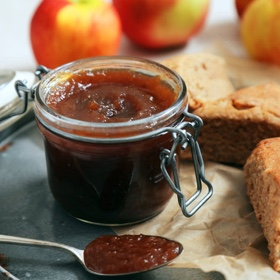

---
categories:
- 9B3E8F54-7F9D-4782-919F-ACC9A0850C87
- 60FB6093-F8C4-447B-A9A2-81A75BBCBA70
- 1C21D75E-3CF2-4B23-B04F-A9275BC1033B
- 98E4F68D-11D7-4383-90FA-22C804880E1C
cook_time: ''
created: '2022-10-12 12:53:17'
difficulty: ''
hash: 11bfa76ef227d00b0137ed3e2bfb29b1454417a441d99164b7e88be51935df1d
image_url: https://static01.nyt.com/images/2017/09/28/dining/28COOKING-APPLEBUTTER/28COOKING-APPLEBUTTER-articleLarge.jpg
in_trash: false
is_pinned: false
on_favorites: false
on_grocery_list: false
prep_time: ''
rating: 0
scale: null
servings: About 4 cups
source: cooking.nytimes.com
source_url: https://cooking.nytimes.com/recipes/1018949-apple-butter
total_time: 3 hr
uid: 7FC9363E-B92D-49CB-AA6D-B4EB7B0C7C58
---

# Apple Butter

## Ingredients

- 4 pounds apples (about 10 to 12 medium), washed, unpeeled, uncored, cut into 1-inch chunks
- 1/2 cup apple cider vinegar
- 3 allspice berries (optional)
- 2 cinnamon sticks (optional)
- 1 2-inch piece of ginger, peeled and sliced (optional)
- 1 star anise pod (optional)
- 1 1/4 cups granulated sugar
- 1 cup light brown sugar
- Small pinch kosher salt

## Directions

Combine apples, vinegar, allspice berries (if using), cinnamon sticks (if using), ginger (if using), star anise pod (if using) and 4 cups water in a large, heavy bottomed pot over high heat. Bring to a simmer and reduce heat to medium-low. Cook, stirring occasionally, until the apples are completely softened and the liquid has reduced by half, 30 to 40 minutes. (Some pieces of apple might float at first; they will sink and become submerged as they soften.) Remove from heat and let cool slightly.

Leaving behind allspice berries, cinnamon sticks and star anise pod, pass the apples through a food mill. (Alternatively, working in batches, ladle apples into a strainer or colander, and using a ladle, wooden spoon or spatula, press apples to pass pulp through, leaving behind seeds and skin.)

To finish on the stovetop: Place apple pulp in the same large, heavy-bottomed pot, add granulated sugar and light brown sugar and stir to dissolve. Cook on medium-low heat, stirring occasionally, until mixture is thick, glossy and a deep golden brown (somewhere between honey and molasses), 2 to 2 1/2 hours. (Around the 1 1/2-hour mark, things will start to bubble rather violently. Stirring constantly will help, but expect, and be careful of, a few splatters.) To test the thickness, spoon a bit onto a plate: The mixture should set almost immediately with no spreading or wateriness. If it’s not there yet, cook another 8 to 10 minutes and test again. When the desired consistency is reached, season with kosher salt.

To finish in the oven: Heat oven to 300 degrees. Place apple pulp in a 9-inch by 13-inch (3-quart) baking dish, add granulated sugar and light brown sugar and stir to dissolve. Place in oven and let cook, stirring every 30 minutes or so, until mixture is thick, glossy and a deep, golden brown color (somewhere between honey and molasses), 3 to 3 1/2 hours. To test the thickness, spoon a bit onto a plate: The mixture should set almost immediately with no spreading or wateriness. If it’s not there yet, cook another 20 to 30 minutes and test again. When the desired consistency is reached, season with kosher salt.

## Nutritional Information

Fat: 0 grams
Calories: 311
Saturated Fat: 0 grams
Unsaturated Fat: 0 grams
Sodium: 19 milligrams
Sugar: 72 grams
Fiber: 5 grams
Carbohydrate: 80 grams
Protein: 1 gram
