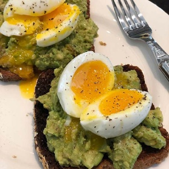

---
categories:
- 595E8D63-42D3-4E28-88A2-D6D54EF026A1
- EAB653D6-0540-48C4-B9D0-FD56AE24841E
- 0B4EDF55-58AC-4E2F-9ACC-EA7C5317BA40
- 98E4F68D-11D7-4383-90FA-22C804880E1C
cook_time: ''
created: '2021-02-15 20:05:38'
difficulty: ''
hash: 159819680328d1ce9935a178774c0bfabf577cb0449cc8159fc558f25388f3df
image_url: https://d14iv1hjmfkv57.cloudfront.net/assets/recipes/avocado-toasts/_600x600_crop_center-center_61_line/IMG_1209.jpg?mtime=20200529114147&focal=none&tmtime=20200930132624
in_trash: false
is_pinned: false
on_favorites: false
on_grocery_list: false
prep_time: ''
rating: 0
scale: null
servings: Serves 2
source: barefootcontessa.com
source_url: https://barefootcontessa.com/recipes/avocado-toasts
total_time: ''
uid: EE19E755-175A-4FC5-A388-AE29455A590E-10855-00000343827F14BA
---

# Avocado Toasts

## Ingredients

- 4 extra-large eggs
- 4 large (1/2-inch-thick) slices rustic or whole grain bread
- 2 ripe Hass avocados, halved, pitted, and peeled
- 2 tbsp freshly squeezed lemon juice
- 1/2 tsp Sriracha
- Kosher salt and freshly ground pepper

## Directions

Fill a medium saucepan with water and bring to a simmer. Very carefully (you don’t want to crack the shells!), lower the eggs into the pan with a spoon. Simmer the eggs for exactly 6 1/2 minutes, take them out of the water and run them under cool tap water, until cool enough to handle. Peel the eggs and set them aside.

Meanwhile, toast the bread in a toaster and place two pieces of toast on each of two plates. Place the avocados in a bowl with the lemon juice, Sriracha, 1 tsp salt and 1/2 tsp pepper and mash them with a fork.

Divide the avocado mixture among the four pieces of bread and spread it out with a knife. Place one egg on each toast, cut it in half, sprinkle with salt and pepper, and serve warm.
