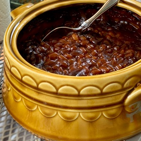

---
categories:
- 9B3E8F54-7F9D-4782-919F-ACC9A0850C87
- F0D08EC3-D9EF-4F02-A381-FF3D38660DA6
- 1C21D75E-3CF2-4B23-B04F-A9275BC1033B
- 2BBE169B-4709-4377-8F54-765FFAAD9E1A
cook_time: ''
created: '2022-04-10 10:30:54'
difficulty: ''
hash: 78d2efd3d3d0897810af971719d7af114cf798227715e76261b810789b98537b
image_url: null
in_trash: false
is_pinned: false
on_favorites: false
on_grocery_list: false
prep_time: ''
rating: 0
scale: null
servings: ''
source: ''
source_url: ''
total_time: ''
uid: F0DC7BBF-5415-4A69-8194-042ED156C830
---

# Baked Beans

## Ingredients

- 2 large cans b beans  Original flavor Bush's beans  (or 4 small)
- 1/3 cup brown sugar
- 1/2 tsp dry mustard

## Directions

Spray casserole dish.  Put one large can beans in dish.  Mix b sugar and dry mustard.  sprinkle half of it over 1st layer of beans.  Add next can of beans and spread remaining sugar/mustard mix.  Bake 300°F for 2-3 hours.

## Notes

You can squirt some ketchup over the top before baking but I don't do that.  - Mom
