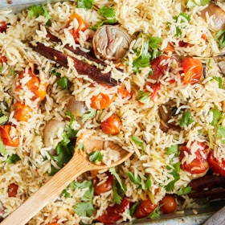

---
categories:
- 135D8DF8-5165-487A-9161-61345003AB1B
- F0D08EC3-D9EF-4F02-A381-FF3D38660DA6
- A774024D-4AFA-4EB2-B28E-8925ACA5E85C
- 2BBE169B-4709-4377-8F54-765FFAAD9E1A
cook_time: ''
created: '2023-07-15 13:33:01'
difficulty: ''
hash: 074d8f638489a517e1bcc5f9672df3d9046bacabc1b961cf66681fa83358ca51
image_url: https://static01.nyt.com/images/2018/09/26/dining/ottolenghi-baked-rice-horizontal/ottolenghi-baked-rice-horizontal-videoSixteenByNineJumbo1600.jpg
in_trash: false
is_pinned: false
on_favorites: false
on_grocery_list: false
prep_time: ''
rating: 0
scale: null
servings: 4 to 6 servings
source: cooking.nytimes.com
source_url: https://cooking.nytimes.com/recipes/1019616-baked-rice-with-slow-roasted-tomatoes-and-garlic
total_time: 1 hr 45 min
uid: 5581830E-80AF-4AE5-BE8D-A0D4E668B6C8
---

# Baked Rice with Slow-Roasted Tomatoes and Garlic

## Ingredients

- 1 3/4 pounds cherry tomatoes
- 12 large garlic cloves
- 4 large shallots, cut into 1 1/4-inch pieces
- 1 1/4 cup cilantro stems, cut into 1 1/2-inch pieces
- 3 tablespoons fresh thyme leaves
- 4 small cinnamon sticks
- 1 teaspoon fine sea salt, more as needed
- Black pepper, as needed
- 7 tablespoons extra-virgin olive oil
- 1 1/2 cups basmati rice
- 2 1/2 cups boiling water
- 1/2 cup cilantro leaves, roughly chopped

## Directions

Heat oven to 350 degrees.

In an 8-by-12-inch casserole dish, toss together tomatoes, garlic, shallots, cilantro stems, thyme, cinnamon sticks, 1/2 teaspoon salt and pepper to taste. Pour oil over everything, then bake until vegetables are soft, about 1 hour. Remove from oven and increase oven temperature to 450.

Without stirring anything, sprinkle rice evenly over vegetables. Top with remaining 1/2 teaspoon salt and plenty of black pepper.

Carefully pour boiling water over rice, then cover dish tightly with foil and bake for 25 minutes, until rice is cooked. Remove from oven and set aside for 10 minutes, still covered.

Remove foil, gently stir in cilantro leaves, taste and add more salt if needed, and serve.

## Nutritional Information

Trans Fat: 0 grams
Fat: 17 grams
Calories: 393
Saturated Fat: 2 grams
Unsaturated Fat: 14 grams
Sodium: 411 milligrams
Sugar: 8 grams
Fiber: 5 grams
Carbohydrate: 57 grams
Protein: 7 grams
