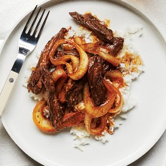

---
categories:
- 135D8DF8-5165-487A-9161-61345003AB1B
- 55A42913-CF04-4D09-BB3B-A0886EAA8EC1
- 1C21D75E-3CF2-4B23-B04F-A9275BC1033B
- 98E4F68D-11D7-4383-90FA-22C804880E1C
cook_time: ''
created: '2020-02-16 09:17:50'
difficulty: ''
hash: 2be2ba9144b9adbb56927907b424c735ead845ce90ee20c25156e4261a814741
image_url: https://assets.bonappetit.com/photos/5d4ddd5ba4141200091cc7f5/16:9/w_1880,c_limit/BA-0919-Beef-Ginger-Stirfry-Playbook.jpg
in_trash: false
is_pinned: false
on_favorites: false
on_grocery_list: false
prep_time: ''
rating: 0
scale: null
servings: 4 servings
source: Bonappetit.com
source_url: https://www.bonappetit.com/recipe/beef-and-ginger-stir-fry
total_time: ''
uid: B656D3AB-5883-41C8-8B4F-A63CEBEBCF40
---

# Beef and Ginger Stir-Fry

## Ingredients

- 1 lb skirt steak, trimmed, sliced against the grain into 1/4"-thick strips, patted dry
- 1 tsp sugar
- 1 tsp toasted sesame oil
- 1 tsp plus 1 tbsp soy sauce
- 1 tsp kosher salt, plus more
- 1 tbsp vegetable oil
- 1 medium sweet onion, sliced into 1/2"-thick rounds
- 1 3" piece ginger, peeled, very thinly sliced
- Freshly ground black pepper
- 3 tbsp unsalted butter, cut into pieces
- 1 tbsp fresh lemon juice
- Cooked rice (for serving)

## Directions

Mise en place guide:

**Medium bowl (marinates 20 minutes):**
- 1 lb skirt steak, trimmed, sliced against the grain into 1/4"-thick strips, patted dry
- 1 tsp sugar
- 1 tsp sesame oil
- 1 tsp soy sauce
- 1 tsp salt

**Cutting board:**
- 1 medium sweet onion, sliced into 1/2"-thick rounds
- 1 3" piece ginger, peeled and very thinly sliced

**Small dish:**
- black pepper (lots)
- 1/3 cup water

**Small dish (add off the heat):**
- 3 tbsp butter, cut into pieces
- 1 tbsp lemon juice
- 1 tbsp soy sauce

**Pot:**
- cooked rice, kept warm for serving

Toss steak in a medium bowl with sugar, sesame oil, 1 tsp soy sauce, and 1 tsp salt to coat and let sit 20 minutes.

Place a large skillet over high heat. Pour in vegetable oil and swirl to coat bottom of pan. The oil should be shimmering and you should see some wisps of smoke—if it’s not hot enough, the meat will steam instead of getting deeply browned.

Add steak to skillet in an even layer (it’s okay to crowd it a bit) and cook, undisturbed, until brown around the edges, about 2 minutes. Turn steak over and add onion, ginger, lots of pepper, and 1/3 cup water. Cook, tossing often, until onion is just tender and ginger is softened, about 2 minutes.

Remove skillet from heat and add butter, lemon juice, and remaining 1 tbsp soy sauce. Toss until butter is melted and coats steak. Taste and season with more salt if needed.

Divide rice among bowls and top with beef stir-fry.
