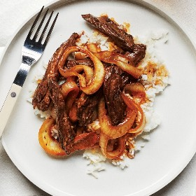

---
categories:
- 135D8DF8-5165-487A-9161-61345003AB1B
- 55A42913-CF04-4D09-BB3B-A0886EAA8EC1
- 1C21D75E-3CF2-4B23-B04F-A9275BC1033B
- 98E4F68D-11D7-4383-90FA-22C804880E1C
cook_time: ''
created: '2020-02-16 09:17:50'
difficulty: ''
hash: 66bc5e2217042cba253f1baaedb9b6aa5fc6f9e327f019e138853b30ad4deb64
image_url: https://assets.bonappetit.com/photos/5d4ddd5ba4141200091cc7f5/16:9/w_1880,c_limit/BA-0919-Beef-Ginger-Stirfry-Playbook.jpg
in_trash: false
is_pinned: false
on_favorites: false
on_grocery_list: false
prep_time: ''
rating: 0
scale: null
servings: 4 servings
source: Bonappetit.com
source_url: https://www.bonappetit.com/recipe/beef-and-ginger-stir-fry
total_time: ''
uid: B656D3AB-5883-41C8-8B4F-A63CEBEBCF40
---

# Beef and Ginger Stir-Fry

## Ingredients

- 1 lb. skirt steak, trimmed, sliced against the grain into ¼"-thick strips, patted dry
- 1 tsp. sugar
- 1 tsp. toasted sesame oil
- 1 tsp. plus 1 Tbsp. soy sauce
- 1 tsp. kosher salt, plus more
- 1 Tbsp. vegetable oil
- 1 medium sweet onion, sliced into ½"-thick rounds
- 1 3" piece ginger, peeled, very thinly sliced
- Freshly ground black pepper
- 3 Tbsp. unsalted butter, cut into pieces
- 1 Tbsp. fresh lemon juice
- Cooked rice (for serving)

## Directions

Toss steak in a medium bowl with sugar, sesame oil, 1 tsp. soy sauce, and 1 tsp. salt to coat and let sit 20 minutes.

Place a large skillet over high heat. Pour in vegetable oil and swirl to coat bottom of pan. The oil should be shimmering and you should see some wisps of smoke—if it’s not hot enough, the meat will steam instead of getting deeply browned.

Add steak to skillet in an even layer (it’s okay to crowd it a bit) and cook, undisturbed, until brown around the edges, about 2 minutes. Turn steak over and add onion, ginger, lots of pepper, and ⅓ cup water. Cook, tossing often, until onion is just tender and ginger is softened, about 2 minutes.

Remove skillet from heat and add butter, lemon juice, and remaining 1 Tbsp. soy sauce. Toss until butter is melted and coats steak. Taste and season with more salt if needed.

Divide rice among bowls and top with beef stir-fry.
