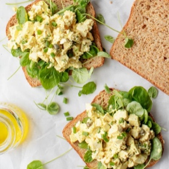

---
categories:
- A6695F02-BB88-4BF3-9B3A-4F3FB0ACFBBA
- EAB653D6-0540-48C4-B9D0-FD56AE24841E
- 0B4EDF55-58AC-4E2F-9ACC-EA7C5317BA40
- 088012EF-69C0-412F-BD34-160FE5B0E043
cook_time: 25 mins
created: '2021-08-03 13:28:58'
difficulty: ''
hash: c0d539ddd13bb4ea5bbb140cb6079edd349c398b7576a9ac4e441dd37c1a6620
image_url: https://cdn.loveandlemons.com/wp-content/uploads/2020/04/egg-salad-580x809.jpg
in_trash: false
is_pinned: false
on_favorites: false
on_grocery_list: false
prep_time: 10 mins
rating: 0
scale: null
servings: Serves 3
source: loveandlemons.com
source_url: https://www.loveandlemons.com/egg-salad/
total_time: ''
uid: E9260063-E184-4721-86EF-AD065779B9D8
---

# Best Egg Salad

## Ingredients

- 1/4 cup mayonnaise
- 1 tsp extra-virgin olive oil
- 2 tsp Dijon mustard
- 1 tsp capers
- 1 tsp fresh lemon juice
- 1 small garlic clove, minced
- 1/4 tsp turmeric
- 1/4 tsp sea salt
- Freshly ground black pepper
- 6 hard boiled eggs, diced
- Pinches of celery seed
- 2 tbsp chopped fresh dill
- 2 tbsp chopped fresh chives

## Directions

In a small bowl, whisk together the mayonnaise, olive oil, mustard, capers, lemon juice, garlic, turmeric, salt, and several grinds of black pepper.

Mix in the eggs, then stir in the celery seed, dill, and chives. If desired, lightly mash the mixture if it's too chunky. Chill until ready to serve.
