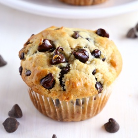

---
categories:
- 6BF378BD-8FD0-4FEF-9755-940308F0C8C7
- 60FB6093-F8C4-447B-A9A2-81A75BBCBA70
- E5311B89-BA3B-4153-9D9E-C809730BC236
- 2BBE169B-4709-4377-8F54-765FFAAD9E1A
cook_time: ''
created: '2021-02-02 15:18:32'
difficulty: ''
hash: 014e63d33d6b2687feca7b60b7a8f80267004a32cb18ad2cbf73ee48ead93939
image_url: https://thebusybaker.ca/wp-content/uploads/2018/08/best-ever-greek-yogurt-chocolate-chip-muffins-fbig3.jpg
in_trash: false
is_pinned: false
on_favorites: false
on_grocery_list: false
prep_time: ''
rating: 0
scale: null
servings: ''
source: thebusybaker.ca
source_url: https://thebusybaker.ca/best-ever-greek-yogurt-chocolate-chip-muffins/
total_time: ''
uid: 59AD29E3-78A2-47F4-9B26-2018EABC9BE2-989-000000E93B3AF1D6
---

# Best Ever Greek Yogurt Chocolate Chip Muffins

## Ingredients

- 1 1/2 cups all purpose flour
- 1/2 cup white sugar
- 1 1/2 teaspoon baking powder
- 1/2 teaspoon salt
- 1/4 cup skim milk
- 3/4 cup low fat Greek yogurt (1-2%)
- 1/4 cup vegetable oil
- 2 eggs
- 1 teaspoon vanilla extract
- 1 cup dark or semi-sweet chocolate chips

## Directions

Preheat your oven to 350 degrees Fahrenheit and line a 12-cup muffin tin with paper liners.

In a large bowl whisk together the flour, sugar, baking powder and salt.

Add the milk, Greek yogurt, vegetable oil, eggs and vanilla and stir everything together with a wooden spoon or a spatula.

Gently stir in the chocolate chips once everything is combined, just until they're distributed evenly throughout.

Portion the batter into the 12 muffin cups evenly and bake at 350 degrees Fahrenheit for 22-25 minutes, or until the muffins are cooked through (test with a toothpick!) and are a light golden brown colour on top.

Let the muffins cool for several minutes and enjoy warm.

## Nutritional Information

Calories: 238kcal Author: Chrissie (thebusybaker.ca)
Serving: 1serving | Calories: 238kcal | Carbohydrates: 29g | Protein: 5g | Fat: 11g | Saturated Fat: 7g | Cholesterol: 29mg | Sodium: 117mg | Potassium: 191mg | Fiber: 2g | Sugar: 15g | Vitamin A: 58IU | Calcium: 60mg | Iron: 2mg
