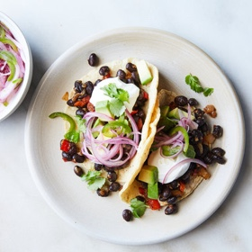

---
categories:
- 135D8DF8-5165-487A-9161-61345003AB1B
- F0D08EC3-D9EF-4F02-A381-FF3D38660DA6
- F254E705-1305-4DF7-9238-5C500D4EF54E
- 98E4F68D-11D7-4383-90FA-22C804880E1C
cook_time: 45 minutes
created: '2020-03-29 18:05:23'
difficulty: ''
hash: 98db9685711701e55d8a85af7e99415659345c9af06361490b4e76992e1cc4cb
image_url: https://static01.nyt.com/images/2019/12/31/dining/31lessmeat3/merlin_166281633_4c04e1be-a088-4a46-9eda-ba5b1ff60eee-articleLarge.jpg
in_trash: false
is_pinned: false
on_favorites: false
on_grocery_list: false
prep_time: ''
rating: 0
scale: null
servings: Yield 4 servings
source: cooking.nytimes.com
source_url: https://cooking.nytimes.com/recipes/1020744-black-bean-tacos-with-avocado-and-spicy-onions
total_time: ''
uid: 11B3B296-D0D1-4E28-AB35-A31AA927F196-456-000000339BE71D33
---

# Black Bean Tacos with Avocado and Spicy Onions

## Ingredients

- FOR THE SPICY ONIONS:
- 1 lime
- 1 small red onion or large shallot, thinly sliced
- 1 jalapeño, seeded and thinly sliced
- Large pinch of fine sea salt
- Small pinch of granulated sugar
- FOR THE BLACK BEANS:
- 2 tbsp olive oil, plus more as needed
- 1 large onion, chopped
- 1/2 cup diced red or green bell pepper
- 2 garlic cloves, minced
- 1 jalapeño, seeded and minced
- 1 tbsp tomato paste
- 1/2 tbsp chili powder
- 1/2 tsp dried oregano
- 1/2 tsp ground cumin
- 2 (15 oz) cans black beans, drained and rinsed
- Fine sea salt
- Corn tortillas, warmed
- 1 avocado, peeled, pitted and sliced
- Fresh cilantro, salsa and sour cream, for garnish (optional)

## Directions

Make the spicy onions: Squeeze the lime into a bowl and add the onion or shallot, jalapeño, salt and sugar to the juice. Set aside while you make the black beans.

Prepare the beans: Heat a large skillet, then add 2 tbsp oil. When oil is hot, add the onion and bell pepper and sauté until soft and golden, about 10 minutes. If the pan looks dry, drizzle in a little more oil.

Add the garlic and jalapeño and sauté until fragrant, 1 minute. Stir in tomato paste, chili powder, oregano and cumin, and sauté until fragrant. Add the beans and a few large pinches of salt and let simmer until the flavors meld, about 15 minutes.

Taste and add more salt, chili powder and oregano to taste. Serve beans with tortillas and avocado and top with the pickled onions and jalapeño and some of their liquid, adding any of the garnishes you like.
