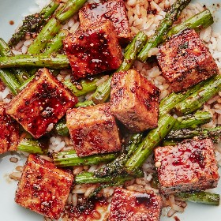

---
categories:
- 135D8DF8-5165-487A-9161-61345003AB1B
- F0D08EC3-D9EF-4F02-A381-FF3D38660DA6
- 1C21D75E-3CF2-4B23-B04F-A9275BC1033B
- 98E4F68D-11D7-4383-90FA-22C804880E1C
cook_time: ''
created: '2020-06-02 08:02:26'
difficulty: ''
hash: 00f76ea9fc5bfa96eb2c3ffeb4935fc28b1f5498e15cab203ff602910cc43fe3
image_url: https://assets.bonappetit.com/photos/5eb5c703af0a613afd3886f0/16:9/w_1880,c_limit/HLY-Black-Pepper-Tofu-6x9.jpg
in_trash: false
is_pinned: false
on_favorites: false
on_grocery_list: false
prep_time: ''
rating: 0
scale: null
servings: 2 servings
source: Bonappetit.com
source_url: https://www.bonappetit.com/recipe/black-pepper-tofu-and-asparagus
total_time: ''
uid: 4F907E9E-ACB7-4C69-B43E-28F352EFB064
---

# Black Pepper Tofu and Asparagus

## Ingredients

- 1 (14 oz) package firm or extra-firm tofu, drained
- 1 tbsp black peppercorns
- 2 garlic cloves
- 1 1/2" piece ginger, peeled
- 1 tbsp cornstarch
- 1/2 tsp kosher salt
- 3 tbsp extra-virgin olive oil
- 1 lb asparagus, trimmed, cut into 1 1/2" pieces
- 1/3 cup soy sauce
- 1 tbsp sugar
- 1 tsp unseasoned rice vinegar
- Cooked white or brown rice (for serving)

## Directions

Wrap tofu in a clean kitchen towel and place in a shallow baking dish or on a rimmed baking sheet. Weigh down with a heavy object (a cast-iron skillet topped with a couple of heavy cans works well). Let sit at least 15 minutes and up to 1 hour (go the full time if you can).

Meanwhile, coarsely crack peppercorns in a spice mill or with a mortar and pestle (you can use a chef’s knife or a very heavy object, although be prepared for some peppercorns to fly!); set aside. Finely grate garlic and ginger into a small bowl; set aside.

Unwrap tofu and cut into 1" cubes. Transfer tofu to a medium bowl. Add cornstarch and salt and toss gently to coat tofu.

Heat oil in a large nonstick skillet over medium-high. Arrange tofu in skillet in a single layer and cook, turning occasionally, until golden brown and crisp all over, 6-8 minutes. Using tongs or a slotted spoon, transfer to a large plate or baking sheet.

Reduce heat to medium and add reserved cracked pepper to skillet. Cook, stirring often, until very fragrant, about 2 minutes, then add asparagus and cook, stirring often, until bright green, about 1 minute. Add reserved garlic and ginger and cook, stirring constantly, until fragrant, about 1 minute.

Return tofu to pan and gently toss to combine. Increase heat to medium-high, add soy sauce and sugar, and cook, tossing occasionally, until sauce thickens slightly, about 3 minutes. Remove from heat and add vinegar. Taste and add more salt and/or vinegar if needed.

To serve, divide rice among plates and top with tofu mixture.
