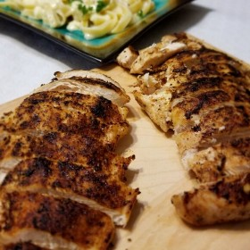

---
categories:
- A3FA97E2-41F7-4C28-8433-211311D4E130
cook_time: ''
created: '2020-01-26 10:39:51'
difficulty: ''
hash: 2de10adf3443cc3a426595e3da4379b4bc26d3b8f9bf630ef535066d57082f08
image_url: https://imagesvc.meredithcorp.io/v3/mm/image?url=https%3A%2F%2Fimages.media-allrecipes.com%2Fuserphotos%2F4538204.jpg&w=582&h=774.0600000000001&c=sc&poi=face&q=85
in_trash: false
is_pinned: false
on_favorites: false
on_grocery_list: false
prep_time: ''
rating: 0
scale: null
servings: 'Servings: 2'
source: Allrecipes.com
source_url: https://www.allrecipes.com/recipe/8571/blackened-chicken/
total_time: ''
uid: 3105470C-D221-4E5B-9D4C-614039F0CEED
---

# Blackening Seasoning

## Ingredients

- 1/2 tsp paprika
- 1/8 tsp salt
- 1/4 tsp cayenne pepper
- 1/4 tsp ground cumin
- 1/4 tsp dried thyme
- 1/8 tsp ground white pepper
- 1/8 tsp onion powder

## Directions

Mix.
