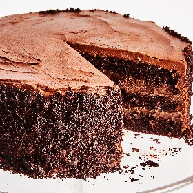

---
categories:
- 6BF378BD-8FD0-4FEF-9755-940308F0C8C7
- 60FB6093-F8C4-447B-A9A2-81A75BBCBA70
- E5311B89-BA3B-4153-9D9E-C809730BC236
- 2BBE169B-4709-4377-8F54-765FFAAD9E1A
cook_time: ''
created: '2021-02-10 11:17:35'
difficulty: ''
hash: 030c56326c57358327c8ab3e1c76ac9f63664aac8edf99fe03c1819963dadd33
image_url: https://assets.bonappetit.com/photos/59c924dc32e4b84f5a9e437a/1:1/w_2560%2Cc_limit/1017%252520WEB%252520WEEK1060.jpg
in_trash: false
is_pinned: false
on_favorites: false
on_grocery_list: false
prep_time: ''
rating: 0
scale: null
servings: 12 servings
source: Bonappetit.com
source_url: https://www.bonappetit.com/recipe/blackout-cake
total_time: ''
uid: 792012CD-22C2-42E2-9AF3-9AAEB7DB71A6
---

# Blackout Cake

## Ingredients

- Unsalted butter, room temperature (for pans)
- 3/4 cup Dutch-processed cocoa powder, plus more for pans
- 1 1/2 cups all-purpose flour
- 1 1/2 tsp baking soda
- 3/4 tsp baking powder
- 1 large egg, room temperature
- 1 large egg yolk, room temperature
- 1 1/2 cups (packed) dark brown sugar
- 3/4 cup sour cream, room temperature
- 5 tbsp vegetable oil
- 2 tsp vanilla extract
- 3/4 tsp kosher salt
- 1/3 cup Dutch-processed cocoa powder
- 5 tbsp cornstarch
- 1 1/4 cups heavy cream
- 4 large egg yolks, beaten to blend
- 1 1/4 cups whole milk
- 2/3 cup (packed) dark brown sugar
- 1/4 tsp kosher salt
- 4 oz milk chocolate, chopped
- 1 tsp vanilla extract
- 1 cup heavy cream
- 3 tbsp golden syrup (such as Lyle’s Golden Syrup)
- 1/8 tsp kosher salt
- 12 oz bittersweet chocolate, chopped
- 3/4 cup sour cream, room temperature
- 2 tbsp unsalted butter, room temperature

## Directions

Arrange a rack in center of oven; preheat to 350°F. Line two 8x2"-deep round cake pans with parchment paper. Grease with butter, then dust with cocoa powder, tapping out excess.

Sift flour, baking soda, baking powder, and remaining 3/4 cup cocoa powder into a medium bowl, then whisk to combine. Whisk egg, egg yolk, brown sugar, sour cream, oil, vanilla, salt, and 3/4 cup hot water in a large bowl until smooth. Whisk in dry ingredients until just combined.

Divide batter between prepared pans. Bake cake until a tester inserted into the center comes out clean, 25-35 minutes. Transfer pans to a wire rack; let cake cool completely in pan. Invert onto a plate, then invert again.

Whisk cocoa powder and cornstarch in a large saucepan. Whisk in cream until smooth and no lumps remain. Add egg yolks, milk, brown sugar, and salt; whisk to combine. Bring to a boil over medium-high heat, whisking occasionally, then reduce heat to low. Continue to cook, whisking, until thick and smooth, 1-2 minutes.

Remove from heat and add chocolate and vanilla, stirring until chocolate is melted and mixture is smooth. Strain through a fine-mesh sieve into a medium bowl. Cover with plastic wrap, pressing directly onto surface of hot pudding to prevent a skin from forming. Chill until cold, at least 2 hours.

Using a serrated knife and sawing in long, even strokes, carefully halve cakes lengthwise. Set aside the 3 prettiest layers for assembly. Crumble remaining layer with your fingers into fine crumbs (or push through a wire rack set inside a rimmed baking sheet). Place 1 layer, cut side up, on a platter or cake stand.

Remove plastic from chilled pudding and vigorously whisk until smooth. Using a rubber spatula, spread half of pudding over cake layer on stand, spreading to edges. Top with another cake layer, cut side down, and spread remaining pudding over cake. Top with third cake layer cut side down (leave top bare). Chill cake 1 hour and up to 8 to let pudding firm up.

Bring cream, syrup, and salt to a boil in a large saucepan over medium-high heat. Remove from heat and stir in chocolate, sour cream, and butter. Let sit, stirring occasionally, until chocolate and butter are melted and mixture is smooth and no streaks of white remain. Transfer to a medium bowl. Let frosting sit at room temperature, stirring every 30 minutes or so, until thickened and spreadable (it will look like a broken chocolate sauce at first, but magically, about 1 1/2 hours later, it will start to thicken). Stir until smooth. (If your kitchen is warmer than 72°F, chill frosting 5 minutes. Stir to combine cooler outer edges with warmer center, then chill another 5 minutes. It should be the consistency of sour cream; if not, chill another 5 minutes and stir.)

Spread frosting all over top and sides of chilled cake. The frosting on top should be as smooth and level as possible, but it’s okay if the sides look messy; the crumbs will hide any mistakes you make.

Place cake stand on a sheet tray. Take a handful of cake crumbs and press into sides of cake. Repeat, turning cake as you go, to completely cover sides in crumbs. Sprinkle crumbs on outside edges of top layer.
