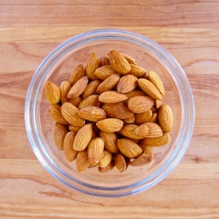

---
categories:
- A3FA97E2-41F7-4C28-8433-211311D4E130
- 98E4F68D-11D7-4383-90FA-22C804880E1C
cook_time: 1 min
created: '2021-12-16 09:12:52'
difficulty: ''
hash: 8c60015e45f3b53d0bcf53fd7bb70f4ed3fa65590ccd7256529632355c64d42c
image_url: https://toriavey.com/images/2012/10/How-to-Blanch-Almonds--900x675.jpg
in_trash: false
is_pinned: false
on_favorites: false
on_grocery_list: false
prep_time: 15 mins
rating: 0
scale: null
servings: '8'
source: toriavey.com
source_url: https://toriavey.com/how-to/how-to-blanch-almonds/
total_time: ''
uid: 89567BD5-CE8B-49D4-95D0-2837AF048804
---

# Blanched Almonds

## Ingredients

- Raw unsalted almonds, more or less as needed
- pot for boiling, strainer

## Directions

Bring a small pot of water to a boil.

Place your raw almonds into the boiling water. Let them boil for exactly one minute. Don't boil for any longer than 60 seconds, or your almonds will start to soften.

Drain the almonds immediately in a colander or strainer and rinse them with cold water to cool them.

Blot the almonds dry with a paper towel. You'll notice that the skins will be slightly shriveled.

Use your fingers to gently squeeze the almonds and loosen the skin from them. Careful, if you squeeze too hard they'll shoot across the room-- which is fun, but not super practical! You can squeeze them from one hand into another to keep them from "launching" too far.

Once you remove the skins, let the almonds dry off completely. Discard the skins.

Now the almonds are blanched and ready to use in your recipe!

## Notes

You will also need: pot of water, paper towels, colander or strainer.

## Nutritional Information

Saturated Fat 4 g
Sodium 21 mg
Potassium 747 mg
Carbohydrates 21 g
Fiber 11 g
Protein 24 g
Calcium 268 mg
Iron 3.7 mg
