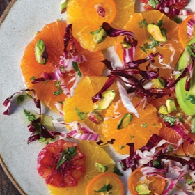

---
categories:
- 9B3E8F54-7F9D-4782-919F-ACC9A0850C87
- 60FB6093-F8C4-447B-A9A2-81A75BBCBA70
- 9B27D475-7644-4A83-9A71-DACE79FB649E
- 088012EF-69C0-412F-BD34-160FE5B0E043
cook_time: ''
created: '2021-02-02 08:27:18'
difficulty: ''
hash: 66e87a00094abe043e038e87c2971cd765a6fe97bda73c9ccd902b964a4d8624
image_url: https://jbf-media.s3.amazonaws.com/production/recipe/2020/1/2/citrus-and-avocado.jpg
in_trash: false
is_pinned: false
on_favorites: false
on_grocery_list: false
prep_time: ''
rating: 0
scale: null
servings: 4 servings
source: jamesbeard.org
source_url: https://www.jamesbeard.org/recipes/citrus-and-avocado-with-limecumin-vinaigrette
total_time: ''
uid: 983988C4-2622-4F38-BA4A-AB82F21C5E57-366-00000091BDB2E50D
---

# CItrus and Avocado With Lime-Cumin Vinaigrette

## Ingredients

- Salad:
- 6 oranges, different varieties preferably seedless
- 1 large ripe but firm avocado
- 2 handfuls finely shredded radicchio, Napa cabbage, or Romaine lettuce
- 1/4 cup pistachio nuts
- Dressing:
- 1 small garlic clove
- Sea salt
- Grated zest of 2 limes
- 3 tbsp of lime juice
- 2 scallions, including an inch or so of the greens, finely sliced
- 1 tbsp jalapeño chile, seeded and finely diced (optional)
- 1/2 tsp cumin seeds
- 1/2 tsp coriander seeds
- 1/4 tsp dry mustard
- 1/4 tsp sweet paprika
- 4 tbsp olive oil
- 2 tbsp finely chopped cilantro

## Directions

Take a slice off the stem end and flower end of each orange so that the fruit stands straight on a cutting board without wobbling. Using a sharp knife, slice down the sides, cutting just beneath the white pith. (Sometimes it takes a few strokes to get under it.) When you’ve removed most of the pith, hold the orange in your hand and slice off any patches that remain, then slice the fruit into rounds about 1/4 inch thick. Do this with all the oranges and put them in a shallow bowl. (If you wish to include thin slices of kumquats, do so.) Cover and refrigerate the slices until you’re ready to serve.

Make the dressing: pound the garlic in a mortar with a 1/2 tsp salt until smooth, after 1/2-minute or so. Add the lime zest, juice, scallions and chile if using. Set aside.

Toast the cumin and coriander seeds in a dry skillet until aromatic, then turn them out on a plate to cool briefly. Grind them to a powder in a spice grinder. Add them along with the rest of the spices to the mortar, then whisk in the oil and add the cilantro. Taste the dressing on a piece of orange to make sure the balance is right.

Halve the avocado, scoop out the flesh and cut it lengthwise into slices.

Pour the dressing over the oranges then scatter the shredded greens and pistachios over the top. Present the salad like this, but toss it a bit as you serve it so that everything is well mixed.

Adapted from In My Kitchen (Ten Speed Press, 2017)
