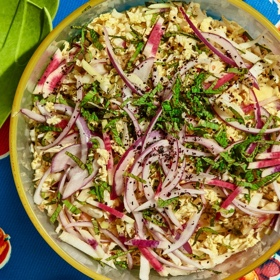

---
categories:
- 9B3E8F54-7F9D-4782-919F-ACC9A0850C87
- 60FB6093-F8C4-447B-A9A2-81A75BBCBA70
- 9B27D475-7644-4A83-9A71-DACE79FB649E
- 088012EF-69C0-412F-BD34-160FE5B0E043
cook_time: ''
created: '2020-05-31 14:32:40'
difficulty: ''
hash: 693099eef43608b5003b015c01c5288a6ddd89761bcf262a8997615722cdaf97
image_url: https://assets.bonappetit.com/photos/5dfbe32041dabe000901c91e/16:9/w_1880,c_limit/Lil-Debs-Cabbage-Salad.jpg
in_trash: false
is_pinned: false
on_favorites: false
on_grocery_list: false
prep_time: ''
rating: 0
scale: null
servings: 4 servings
source: bonappetit.com
source_url: https://www.bonappetit.com/recipe/cabbage-slaw-with-charred-scallions-and-lime-dressing
total_time: ''
uid: 9C9EBD02-77EF-416C-BB3B-041FB4238A62-8154-000003C5D3378F77
---

# Cabbage Slaw with Charred Scallions and Lime Dressing

## Ingredients

- 1 bunch scallions (about 6), trimmed
- 1 habanero chile, seeds removed
- 4 garlic cloves
- Zest of 2 limes
- ½ cup fresh lime juice
- ¼ cup vegetable oil
- Kosher salt
- 1 small head of Napa cabbage, thinly sliced
- 2 large watermelon radishes or one 6" piece daikon (Japanese radish), peeled, cut into ⅛"-thick matchsticks
- Thinly sliced mint and thinly sliced red onion (for serving)

## Directions

Heat a dry medium cast-iron skillet over medium-high. Cook scallions, turning once or twice, until lightly charred in spots, about 3 minutes. Transfer to a blender and add chile, garlic, lime zest and juice, and oil. Blend until smooth; season dressing with salt.

Toss cabbage, radishes, and half of dressing in a large bowl. Taste and season with salt and add more dressing if needed. Top with mint and onion just before serving.
