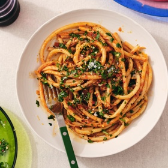

---
categories:
- 135D8DF8-5165-487A-9161-61345003AB1B
- 60FB6093-F8C4-447B-A9A2-81A75BBCBA70
- 460F3A6B-0B87-457B-AF84-A1CE51D92D74
- 98E4F68D-11D7-4383-90FA-22C804880E1C
cook_time: 40 minutes
created: '2020-02-02 12:05:52'
difficulty: ''
hash: 4be1bda5839ac7dfa15200eb51bf8abcb8a8044afbaee09727d8006c2d1e7935
image_url: https://static01.nyt.com/images/2020/01/29/dining/27Romanrex/merlin_167079174_ecc032e7-071b-44ab-8852-0d5025d0e90d-articleLarge.jpg
in_trash: false
is_pinned: false
on_favorites: false
on_grocery_list: false
prep_time: ''
rating: 0
scale: null
servings: Yield 4 servings
source: cooking.nytimes.com
source_url: https://cooking.nytimes.com/recipes/1020830-caramelized-shallot-pasta
total_time: ''
uid: 075F4720-050F-44E9-874A-367BFCCA53B4-10580-0000082ACB86815B
---

# Caramelized Shallot Pasta

## Ingredients

- ¼ cup olive oil
- 6 large shallots, very thinly sliced
- 5 garlic cloves, 4 thinly sliced, 1 finely chopped
- Kosher salt and freshly ground black pepper
- 1 teaspoon red-pepper flakes, plus more to taste
- 1 (2-ounce) can anchovy fillets (about 12), drained
- 1 (4.5-ounce) tube or (6-ounce) can of tomato paste (about 1/2 to 3/4 cup)
- 10 ounces pasta
- 1 cup parsley, leaves and tender stems, finely chopped
- Flaky sea salt

## Directions

Heat olive oil in a large heavy-bottomed Dutch oven over medium high. Add shallots and thinly sliced garlic, and season with salt and pepper. Cook, stirring occasionally, until the shallots have become totally softened and caramelized with golden-brown fried edges, 15 to 20 minutes.

Add red-pepper flakes and anchovies. (No need to chop the anchovies; they will dissolve on their own.) Stir to melt the anchovies into the shallots, about 2 minutes.

Add tomato paste and season with salt and pepper. Cook, stirring constantly to prevent any scorching, until the tomato paste has started to cook in the oil a bit, caramelizing at the edges and going from bright red to a deeper brick red color, about 2 minutes. Remove from heat and transfer about half the mixture to a resealable container, leaving the rest behind. (These are your leftovers to be used elsewhere: in another batch of pasta or smeared onto roasted vegetables, spooned over fried eggs or spread underneath crispy chicken thighs.)

To serve, cook pasta according to package instructions in a large pot of salted boiling water until very al dente (perhaps more al dente than usual). Transfer to Dutch oven with remaining shallot mixture (or a skillet if you are using the leftover portion) and 1 cup pasta water. Cook over medium-high heat, swirling the skillet to coat each piece of pasta, using a wooden spoon or spatula to scrape up any bits on the bottom, until pasta is thick and sauce has reduced and is sticky, but not saucy, 3 to 5 minutes.

In a small bowl, combine parsley and finely chopped garlic clove, and season with flaky salt and pepper. Divide pasta among bowls, or transfer to one large serving bowl, and top with parsley mixture and a bit more red-pepper flakes, if you like.

## Notes

Add garlic later than shallots to prevent over browning.  Takes more like 7-10 minutes

Don’t brown too much during tomato paste add either.

Cook bucatini 8 minutes for very al dente

## Nutritional Information

Calories: 545
Total Carbohydrates: 83 grams
Cholesterol: 12 milligrams
Total Fat: 16 grams
Dietary fiber: 8 grams
Protein: 18 grams
Saturated fat: 2 grams
Sodium: 874 milligrams
