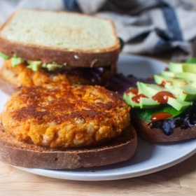

---
categories:
- 135D8DF8-5165-487A-9161-61345003AB1B
- F0D08EC3-D9EF-4F02-A381-FF3D38660DA6
- 7CD3F8E9-6459-40C0-8802-20549A6F50EC
- 98E4F68D-11D7-4383-90FA-22C804880E1C
cook_time: 1 hour
created: '2021-04-05 13:19:51'
difficulty: ''
hash: b7bb3a776edc3812b73085a42a3eef9b935c905c05d3a7ed3323ace8b86ec1c4
image_url: https://i2.wp.com/smittenkitchen.com/wp-content/uploads//2020/03/carrot-and-white-bean-burgers.jpg?fit=750%2C500&ssl=1
in_trash: false
is_pinned: false
on_favorites: false
on_grocery_list: false
prep_time: ''
rating: 0
scale: null
servings: 'Servings: 6 burger patties'
source: smittenkitchen.com
source_url: https://smittenkitchen.com/2020/03/carrot-and-white-bean-burgers/
total_time: ''
uid: 885A743A-F7A2-4711-B714-8A2D4A74D249
---

# Carrot and White Bean Burgers

## Ingredients

- Olive oil
- 1/2 cup panko-style breadcrumbs
- 3 shallots, or 1 small onion, diced
- 1 tablespoon tomato paste
- 1 1/2 teaspoons kosher salt
- 1 cup packed grated carrot (from 2 medium carrots)
- 1 1/2 tablespoons apple cider vinegar
- Two 15-ounce cans cannellini or other white beans, drained and rinsed
- 1 large egg, beaten
- Freshly ground black pepper
- Burger accompaniments, as you like

## Directions

Heat 1 tablespoon olive oil in a large skillet over low heat. Add the panko and cook, stirring often, until lightly browned and crisp, 3 to 5 minutes. Transfer crumbs to a large bowl, then return the pan to the heat.

Add 2 tablespoons olive oil to the skillet, followed by the shallot or onion. Cook until softened and lightly golden, 8 to 10 minutes. Stir in the tomato paste, salt, and carrots and stir frequently until the carrots are soft and a bit blistered, another 8 to 10 minutes. Add the vinegar, scraping up all the browned bits until the pan is dry. Remove from heat and add the bowl with the toasted panko. Add beans and use a wooden spoon or spatula to very coarsely mash the mixture until a bit pasty and the mixture coheres in places—there should still be plenty of beans intact. Add pepper, and more salt if needed, to aste. Stir in the egg. Shape into 6 patties (I used a 1/2 cup measure as a scoop) for the size burger you see here; 4 patties for really large burgers (to warn, I found this size a little unwieldy), or 8 to 10 for slider-size.

To cook the veggie burgers, heat a thin layer of olive oil in a wide skillet over medium heat and carefully cook until browned and slightly firm to the touch, 3 to 4 minutes per side. It may be necessary to cook in batches. Serve hot or at room temperature, with whatever you like on or with veggie burgers.
