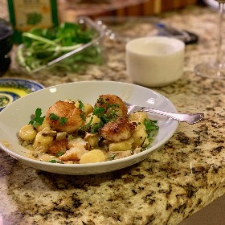

---
categories:
- A3FA97E2-41F7-4C28-8433-211311D4E130
- 98E4F68D-11D7-4383-90FA-22C804880E1C
cook_time: ''
created: '2020-03-07 16:18:41'
difficulty: ''
hash: 5d9c197fe67120deac61d89efaa03ded604704a91e1e2f204ccecdef9debc434
image_url: null
in_trash: false
is_pinned: false
on_favorites: false
on_grocery_list: false
prep_time: ''
rating: 3
scale: null
servings: ''
source: ''
source_url: ''
total_time: ''
uid: 13950AA4-A271-403F-8011-D3521760CE37
---

# Chad's Herb Garlic & Butter Sauce

good sauce to use up fresh herbs.  good with scallops and gnocchi.

## Ingredients

- 1 large yellow onion
- 6 garlic cloves
- 3/4 cup dry white wine
- 1 cup chicken stock
- fresh thyme
- fresh parsley
- fresh basil
- 2 tsp crushed red pepper
- 3/4 stick butter
- 1 lemon
- olive oil

## Directions

Zest & juice lemon, separate and set aside.

Sweat Onion till Browning starts, add garlic halfway through to avoid bitterness.

Bloom red pepper.

Add stock & wine & zest, reduce till nearly evaporated.

Pull from heat add herbs emulsify butter, juice lemon.

## Notes

Easy on the thyme, it's a powerhouse.

Consider lessening butter, and incorporating spicy virgin olive oil after emulsion.
