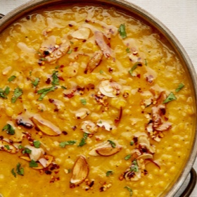

---
categories:
- 135D8DF8-5165-487A-9161-61345003AB1B
- F0D08EC3-D9EF-4F02-A381-FF3D38660DA6
- 641901A6-C962-46DC-B418-1C19B51409EF
- 98E4F68D-11D7-4383-90FA-22C804880E1C
cook_time: ''
created: '2023-01-08 11:05:24'
difficulty: ''
hash: 1bb5b96ab575ed575473f8a2ef5cb14160fc7ba259e237134197f81a2ed24f44
image_url: https://static01.nyt.com/images/2018/04/19/dining/19COOKING-DAL3/19COOKING-DAL3-articleLarge-v3.jpg
in_trash: false
is_pinned: false
on_favorites: false
on_grocery_list: false
prep_time: ''
rating: 0
scale: null
servings: About 4 servings
source: cooking.nytimes.com
source_url: https://cooking.nytimes.com/recipes/1014366-chana-dal-new-delhi-style
total_time: 1 hr
uid: E5AC0F15-19D6-4F95-B0D6-71FB3106E7DB
---

# Chana Dal, New Delhi-Style

## Ingredients

- 1 cup split chickpeas (chana dal)
- 1 1/2 teaspoons turmeric
- 1/2 teaspoon ground cardamom
- 1 bay leaf, preferably Indian
- 1 teaspoon salt
- 2 tablespoons sunflower orsafflower oil
- 6 whole cloves
- 4 large garlic cloves, thinly sliced
- 1 teaspoon crushed-red-chile flakes (optional)
- 3 tablespoons freshly chopped cilantro

## Directions

Combine the chana dal, turmeric,cardamom, bay leaf, salt and 4 cups waterin a large saucepan and bring to a boil.Adjust the heat so the mixture bubblesgently, cover partly and cook for 40minutes. At that point, the mixture shouldstill be quite moist; if it is not, add 1 cupadditional water and continue cooking,covered, until the dal is tender, about 20minutes; turn off the heat. Remove thebay leaf. Use an Indian mathani (see related article)to purée the dal for about 1 minute;the dal should be saucy but not soupy.

To make the tadka, put the oil in asmall saucepan over medium-high heat.When the oil is hot, add the cloves; letsizzle for about 30 seconds until fragrant.Add the garlic and cook, stirringconstantly, until medium brown. Stir inthe chili flakes if you’re using them,and turn off the heat.

Pour the tadka into the dal; stirgently to combine. Garnish with cilantroand serve.

## Nutritional Information

Trans Fat: 0 grams
Fat: 10 grams
Calories: 264
Saturated Fat: 1 gram
Unsaturated Fat: 9 grams
Sodium: 153 milligrams
Sugar: 5 grams
Fiber: 7 grams
Carbohydrate: 34 grams
Protein: 11 grams
