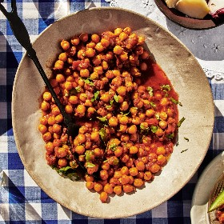

---
categories:
- 135D8DF8-5165-487A-9161-61345003AB1B
- F0D08EC3-D9EF-4F02-A381-FF3D38660DA6
- 641901A6-C962-46DC-B418-1C19B51409EF
- 98E4F68D-11D7-4383-90FA-22C804880E1C
cook_time: ''
created: '2023-06-25 15:48:58'
difficulty: ''
hash: ce56ae66e83e07665beb5305f20610b30f9eb6afa8f731febb50fc72e91ca57d
image_url: https://assets.bonappetit.com/photos/60775dd7e1360146c458ce9e/1:1/w_2560%2Cc_limit/0521-Yasmin-Khan-Chana-Masala.jpg
in_trash: false
is_pinned: false
on_favorites: false
on_grocery_list: false
prep_time: ''
rating: 0
scale: null
servings: 4 servings
source: Bonappetit.com
source_url: https://www.bonappetit.com/recipe/chana-masala
total_time: ''
uid: E87D5E78-64FF-4A7C-90FF-C02C48B4C2DB
---

# Chana Masala

## Ingredients

- 3 tbsp vegetable oil
- 1 medium onion, finely chopped
- 1 tsp coriander seeds
- 1 tsp cumin seeds
- 4 garlic cloves, finely chopped
- 1 2" piece ginger, peeled, finely chopped
- 1 tsp garam masala
- 1/4 tsp ground turmeric
- Pinch of cayenne pepper or crushed red pepper flakes
- 1 medium tomato, peeled, chopped
- 2 (14.5 oz) cans chickpeas, rinsed
- 1 tbsp double-concentrated tomato paste
- Kosher salt, freshly ground pepper
- 1 tsp cornstarch
- 2 tbsp extra-virgin olive oil
- Chopped cilantro and rice and/or flatbread (for serving)
- A spice mill or mortar and pestle

## Directions

Heat vegetable oil in a large saucepan or small pot over medium-low. Cook onion, stirring occasionally, until golden brown and very tender, 15-20 minutes.

Meanwhile, toast coriander seeds and cumin seeds in a dry small skillet over medium heat, tossing occasionally, until slightly darkened and fragrant, about 2 minutes. Transfer to spice mill or mortar and pestle and let cool; finely grind.

Add spice mixture, garlic, ginger, garam masala, turmeric, and cayenne to pan with onion. Cook, stirring, until fragrant, about 3 minutes. Add tomato, chickpeas, tomato paste, and 2 cups very hot water; season with salt and pepper. Cover pan; simmer, adding up to 1 cup more hot water if chana masala looks dry, until chickpeas are very tender and sauce is flavorful, 45-60 minutes.

Stir cornstarch and 2 tsp water in a small bowl, then stir into chana masala. Simmer just until thickened, about 1 minute. Remove from heat and stir in olive oil. Season with more salt if needed.

Top chana masala with cilantro and serve with rice and/or flatbread.

## Nutritional Information

Calories (kcal) 220
Fat (g) 9
Saturated Fat (g) 1
Cholesterol (mg) 0
Carbohydrates (g) 29
Dietary Fiber (g) 7
Sodium (mg) 800
