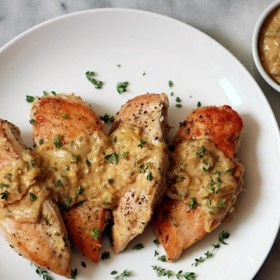

---
categories:
- 135D8DF8-5165-487A-9161-61345003AB1B
- E131025A-19E9-4C5F-99A8-75EE51F165D8
- 1C21D75E-3CF2-4B23-B04F-A9275BC1033B
- 98E4F68D-11D7-4383-90FA-22C804880E1C
cook_time: ''
created: '2020-01-26 10:35:53'
difficulty: ''
hash: cb177fea8fd4d68ce738a7e60f7164d55aedb018164d1c6912d27e42aa9819a0
image_url: https://assets.bonappetit.com/photos/57ae4aef53e63daf11a4e4d5/16:9/w_1880,c_limit/chicken-breasts-with-dijon-646.jpeg
in_trash: false
is_pinned: false
on_favorites: false
on_grocery_list: false
prep_time: ''
rating: 0
scale: null
servings: 4 servings
source: Bonappetit.com
source_url: https://www.bonappetit.com/recipe/chicken-breasts-dijon
total_time: ''
uid: 3E7ED922-82A7-4630-9FD5-F1F995940622
---

# Chicken Breasts Dijon

## Ingredients

- 2 tablespoons olive oil
- 4 skinless, boneless chicken breasts (about 1 1/2 pounds)
- Kosher salt and freshly ground black pepper
- 2 small leeks, white and pale-green parts only, thinly sliced (about 1/2 cup)
- 1 small onion, minced (about 1/2 cup)
- 4 garlic cloves, minced
- 2 cups low-salt chicken broth
- 1 cup dry white wine
- 1/2 cup Dijon mustard
- 2 tablespoons minced fresh thyme plus thyme leaves for garnish
- 1 tablespoon unsalted butter

## Directions

Heat oil in a large heavy Dutch oven over medium-high heat. Season chicken breasts with salt and pepper. Place chicken in Dutch oven and cook until brown on both sides, 12-15 minutes total. Transfer to a plate and set aside.

Place leeks and onion in same pot and sauté until tender, about 8 minutes. Add garlic and sauté until tender, about 2 minutes. Stir in broth, wine, Dijon mustard, and minced thyme and bring to a simmer. Return chicken to pot. Cover and simmer over medium-low heat until chicken is cooked through, about 15 minutes.

Transfer chicken to plates. Bring liquid in pot to a boil; cook until sauce is thickened and glossy, about 15 minutes. Whisk in butter and season with salt and pepper. Spoon sauce over chicken and garnish with thyme leaves.
