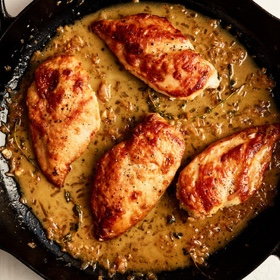

---
categories:
- 135D8DF8-5165-487A-9161-61345003AB1B
- E131025A-19E9-4C5F-99A8-75EE51F165D8
- 1C21D75E-3CF2-4B23-B04F-A9275BC1033B
- 98E4F68D-11D7-4383-90FA-22C804880E1C
cook_time: ''
created: '2022-12-08 12:58:59'
difficulty: ''
hash: a89105fbad4b97b723c0fae3b72c7f05ee34f75fa8bb7904dd06df60e7ab8e56
image_url: https://static01.nyt.com/images/2022/11/08/dining/PF-Chicken-Breasts-with-Lemon/merlin_216285030_fd31034f-e5ef-429f-892d-9846cda8840b-articleLarge.jpg
in_trash: false
is_pinned: false
on_favorites: false
on_grocery_list: false
prep_time: ''
rating: 0
scale: null
servings: 4 servings
source: cooking.nytimes.com
source_url: https://cooking.nytimes.com/recipes/4117-chicken-breasts-with-lemon
total_time: 25 min
uid: F0F368A4-7305-4A20-AC7A-E37282708800
---

# Chicken Breasts with Lemon

## Ingredients

- 1/2 cup flour for dredging
- Salt and freshly ground pepper to taste
- 4 skinless boneless chicken breasts, about 6 ounces each
- 2 tablespoons olive oil
- 4 sprigs fresh thyme or 1 teaspoon dried
- 2 tablespoons finely chopped shallots
- 2 teaspoons finely chopped garlic
- 2 teaspoons grated lemon zest
- 3 tablespoons lemon juice
- 1/2 cup chicken broth, fresh or canned
- 2 tablespoons butter

## Directions

Season flour with salt and pepper, and dredge the chicken all over. Remove the excess flour.

Heat the oil in a heavy skillet large enough to hold the chicken pieces in one layer. Add chicken and cook, uncovered, over medium heat for 5 minutes or until lightly browned.

Flip the chicken and cook for 5 minutes more, or until cooked through. Carefully remove the oil from the skillet, leaving the chicken. Discard the oil.

Add the thyme, shallots and garlic, and cook for about a minute. Do not burn the garlic. Add the lemon rind, the lemon juice and the broth.

Scrape the skillet to dissolve the brown particles that cling to the bottom. Add the butter, and cook for 3 minutes longer. Serve immediately.

## Nutritional Information

Trans Fat: 0 grams
Fat: 18 grams
Calories: 396
Saturated Fat: 6 grams
Unsaturated Fat: 10 grams
Sodium: 584 milligrams
Sugar: 1 gram
Fiber: 1 gram
Carbohydrate: 16 grams
Protein: 41 grams
