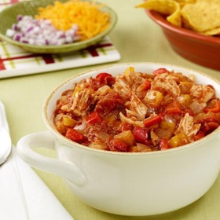

---
categories:
- 135D8DF8-5165-487A-9161-61345003AB1B
- E131025A-19E9-4C5F-99A8-75EE51F165D8
- 1A786DC7-9C26-4F71-B6F4-1B452FC14FB9
- 98E4F68D-11D7-4383-90FA-22C804880E1C
cook_time: 1 hr 45 min
created: '2022-01-09 10:39:11'
difficulty: Easy
hash: a4af5db250aad6fd7082a91ce0c49342f4df380a788f947c08b90cf39edf2f05
image_url: https://food.fnr.sndimg.com/content/dam/images/food/fullset/2009/4/5/0/IG1C03_27660_s4x3.jpg.rend.hgtvcom.616.462.suffix/1384540890111.jpeg
in_trash: false
is_pinned: false
on_favorites: false
on_grocery_list: false
prep_time: 15 min
rating: 0
scale: null
servings: 'Yield: 6 servings'
source: foodnetwork.com
source_url: https://www.foodnetwork.com/recipes/ina-garten/chicken-chili-recipe-1942939
total_time: ''
uid: A363EDBF-ED12-42E8-96B5-4DBEE130D51F
---

# Chicken Chili

## Ingredients

- 4 cups chopped yellow onions (3 onions)
- 1/8 cup good olive oil, plus extra for chicken
- 1/8 cup minced garlic (2 cloves)
- 2 red bell peppers, cored, seeded, and large-diced
- 2 yellow bell peppers, cored, seeded, and large-diced
- 1 tsp chili powder
- 1 tsp ground cumin
- 1/4 tsp dried red pepper flakes, or to taste
- 1/4 tsp cayenne pepper, or to taste
- 2 tsp kosher salt, plus more for chicken
- 2 (28 oz) cans whole peeled plum tomatoes in puree, undrained
- 1/4 cup minced fresh basil leaves
- 4 split chicken breasts, bone in, skin on
- Freshly ground black pepper

## Directions

Cook the onions in the oil over medium-low heat for 10-15 minutes, until translucent. Add the garlic and cook for 1 more minute. Add the bell peppers, chili powder, cumin, red pepper flakes, cayenne, and salt. Cook for 1 minute. Crush the tomatoes by hand or in batches in a food processor fitted with a steel blade (pulse 6-8 times). Add to the pot with the basil. Bring to a boil, then reduce the heat and simmer, uncovered, for 30 minutes, stirring occasionally.

Preheat the oven to 350°F.

Rub the chicken breasts with olive oil and place them on a baking sheet. Sprinkle generously with salt and pepper. Roast the chicken for 35-40 minutes, until just cooked. Let cool slightly. Separate the meat from the bones and skin and cut it into 3/4-inch chunks. Add to the chili and simmer, uncovered, for another 20 minutes. Serve with the toppings, or refrigerate and reheat gently before serving.
