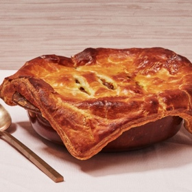

---
categories:
- 135D8DF8-5165-487A-9161-61345003AB1B
- E131025A-19E9-4C5F-99A8-75EE51F165D8
- 1C21D75E-3CF2-4B23-B04F-A9275BC1033B
- 2BBE169B-4709-4377-8F54-765FFAAD9E1A
cook_time: ''
created: '2022-11-13 09:44:47'
difficulty: ''
hash: b21e35390eec99d5bc6b8d7d44cf0ebd557c6e13b36b34d7f86bad87d03fd7e6
image_url: https://assets.bonappetit.com/photos/589a4cfff12ac6e639bf247e/master/w_1280%2Cc_limit/chicken-curry-pot-pie.jpg
in_trash: false
is_pinned: false
on_favorites: false
on_grocery_list: false
prep_time: ''
rating: 0
scale: null
servings: 8 servings
source: bonappetit.com
source_url: https://www.bonappetit.com/recipe/chicken-curry-pot-pie
total_time: ''
uid: 9DAE46E5-22AF-41F1-A513-8A9A713777AB
---

# Chicken Curry Pot Pie

## Ingredients

- 4 tablespoons unsalted butter
- 1 large onion, chopped
- 1 green apple, peeled, chopped
- 1 delicata squash, scrubbed, or 1 small butternut squash, peeled, cut into ¾-inch pieces
- 3 medium carrots, peeled, cut into 1-inch pieces
- 1 medium russet potato, peeled, cut into ½-inch pieces
- 1 small daikon, peeled, cut into ¾-inch pieces
- 6 garlic cloves, thinly sliced
- 1 1-inch piece ginger, finely chopped
- 2 tablespoons curry powder (preferably S&B)
- 2 tablespoons all-purpose flour, plus more for dusting
- 2 cups low-sodium chicken broth
- ¼ cup soy sauce
- 3 tablespoons cornstarch
- Kosher salt
- 1 ½ pounds skinless, boneless chicken thighs, cut into 1-inch pieces
- 1 sheet frozen puff pastry (one 14-ounce package or half of a 17.3-ounce package) or pie dough
- 1 large egg, beaten to blend

## Directions

Preheat oven to 425°. Heat butter in a large shallow braising pot or large skillet (around 12" in diameter) over medium. Cook onion and apple, stirring often, until very soft, 8–10 minutes. Add squash, carrots, potato, daikon, and garlic and cook, stirring occasionally, until vegetables are partly tender, 12–15 minutes. Add ginger and sprinkle with curry powder and 2 Tbsp. flour; cook, stirring to coat, just until curry powder darkens, about 1 minute. Whisk broth, soy sauce, and cornstarch in a small bowl until smooth. Add broth mixture to pot and bring to a simmer, stirring often. Cook, still stirring frequently, until mixture is very thick. Taste and season with salt, if needed. Add chicken and stir to evenly distribute. The mixture will look so thick at this point that it will seem wrong. Trust us, the vegetables and chicken will release liquid as they cook under the pastry, creating a rich and just-thick-enough sauce as they do so.

Roll out puff pastry on a lightly floured surface until large enough to cover pot with an overhang of about 1" on all sides. Drape pastry over pot and press firmly around edges to adhere. Lightly brush with egg and cut 2–3 small slits in the center so that steam can escape.

Bake pot pie until crust is golden brown, about 18–22 minutes, then reduce oven temperature to 350° and continue to bake until filling is bubbling around the edges and crust is well browned, 40–45 minutes longer. Let sit 10 minutes before serving.
