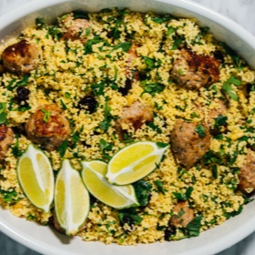

---
categories:
- 135D8DF8-5165-487A-9161-61345003AB1B
- E131025A-19E9-4C5F-99A8-75EE51F165D8
- 1C21D75E-3CF2-4B23-B04F-A9275BC1033B
- 98E4F68D-11D7-4383-90FA-22C804880E1C
cook_time: ''
created: '2023-01-08 11:04:26'
difficulty: ''
hash: 3899c453d36f5a27a4e975af723ef595c29db75df62bda1b812e46197ea0e57f
image_url: https://static01.nyt.com/images/2020/11/05/dining/ns-chicken-kebabs/ns-chicken-kebabs-articleLarge.jpg
in_trash: false
is_pinned: false
on_favorites: false
on_grocery_list: false
prep_time: ''
rating: 0
scale: null
servings: 4 servings
source: cooking.nytimes.com
source_url: https://cooking.nytimes.com/recipes/1021530-chicken-koftas-with-lime-couscous
total_time: 25 min
uid: 9DCF3799-6586-4F94-A2ED-B915CBFFB525
---

# Chicken Koftas with Lime Couscous

## Ingredients

- 1 1/2 cups low-sodium chicken stock
- 2 tablespoons lime juice, plus 1/2 teaspoon lime zest
- 1 tablespoon extra-virgin olive oil
- 1 teaspoon red-pepper flakes, such as Aleppo
- Fine sea salt and freshly ground black pepper
- 1 cup couscous
- 1/4 loosely packed cup chopped flat-leaf parsley leaves
- 1/4 cup dried sweet-tart cherries or cranberries
- 3 tablespoons toasted pine nuts
- 1 pound ground chicken or turkey
- 2 shallots, peeled and minced
- 1 large egg, lightly whisked
- 2 tablespoons chopped flat-leaf parsley leaves
- 1 serrano chile, trimmed and chopped
- 4 garlic cloves, peeled and minced
- 2 tablespoons peeled and grated fresh ginger
- Fine sea salt and freshly ground black pepper
- Olive oil
- 1 lime, cut into wedges, for serving

## Directions

Make the couscous: In a medium saucepan over high heat, bring the stock, lime juice, olive oil, red-pepper flakes and 1 teaspoon salt to a rolling boil. Remove from the heat and stir in the couscous. Cover with a lid and let sit for 10 minutes.

As the couscous sits, prepare the koftas: Place the ground chicken, shallots, egg, parsley, serrano, garlic, ginger, 1 teaspoon salt and 1 teaspoon pepper in the bowl of a food processor and pulse until the mixture resembles a coarse paste.

Heat 2 to 3 tablespoons of olive oil in a large (12-inch) cast-iron skillet or nonstick pan over medium-low. Grease your hands with a little oil and divide and shape the ground chicken mixture into 12 balls. Fry them in the hot oil, in batches if necessary, until golden brown on all sides and the internal temperature reads 165 degrees on an instant-read thermometer, about 8 to 10 minutes. Using a slotted spoon, transfer the koftas to a tray or plate lined with paper towels.

Uncover the couscous, fluff the mixture with a fork and break up any lumps. Transfer the couscous to a large mixing bowl. Fold in the lime zest, parsley, cherries and pine nuts, then season to taste with salt and pepper. Fold in the koftas and serve immediately with the lime wedges.
