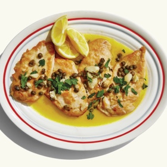

---
categories:
- 135D8DF8-5165-487A-9161-61345003AB1B
- E131025A-19E9-4C5F-99A8-75EE51F165D8
- 1C21D75E-3CF2-4B23-B04F-A9275BC1033B
- 98E4F68D-11D7-4383-90FA-22C804880E1C
cook_time: ''
created: '2020-03-22 14:47:29'
difficulty: ''
hash: 7dab7ba5d8ef5cbc93ef189207a7abfda1d281c7464db45246967fd038701a09
image_url: https://assets.bonappetit.com/photos/5cad19a73733c07592c4a9cd/16:9/w_1880,c_limit/chicken-picatta.jpg
in_trash: false
is_pinned: false
on_favorites: false
on_grocery_list: false
prep_time: ''
rating: 0
scale: null
servings: 4 servings
source: bonappetit.com
source_url: https://www.bonappetit.com/recipe/chicken-piccata-2
total_time: ''
uid: 7EE49867-D0A4-44F6-B68A-AE8010283CC0-60208-00002992E4C196B7
---

# Chicken Piccata

## Ingredients

- 2 large skinless, boneless chicken breasts
- Kosher salt
- ½ cup all-purpose flour
- 3 Tbsp. extra-virgin olive oil, divided
- 4 garlic cloves, smashed
- ⅓ cup dry white wine
- 1 Tbsp. drained capers, coarsely chopped
- 4 Tbsp. unsalted butter, cut into pieces
- 2 Tbsp. fresh lemon juice
- Chopped parsley and lemon wedges (for serving)

## Directions

Slice chicken breasts in half crosswise into 4 cutlets and lightly pound each piece between sheets of plastic wrap until an even thickness (about ½" thick or less). Season lightly with salt. Place flour in a medium shallow bowl. Working one at a time, place cutlets in bowl and toss to coat in flour. Knock off excess flour and transfer to a plate.

Heat 2 Tbsp. oil in a large skillet over medium-high. Working in batches if needed to avoid overcrowding the pan, cook cutlets, without moving them, until deeply browned underneath, about 2 minutes. Turn over and cook on the other side just until chicken is nearly cooked through, about 30 seconds. Transfer to a clean plate.

Add garlic and remaining 1 Tbsp. oil to the skillet and cook, stirring often and reducing heat if needed to keep garlic from scorching, until golden brown, about 2 minutes. Add wine and capers and cook, swirling pan and scraping up any browned bits stuck to the bottom of skillet, until liquid is almost completely evaporated, about 3 minutes. Add ½ cup water, followed by the butter. Swirl pan vigorously while butter melts to help it form an emulsion with water, about 1 minute.

Return chicken to skillet and simmer until chicken is cooked through and sauce is thick enough to coat a spoon, about 2 minutes. Remove from heat and stir lemon juice into sauce; season with salt. Transfer chicken and sauce to a platter and top with parsley; serve with lemon wedges.
