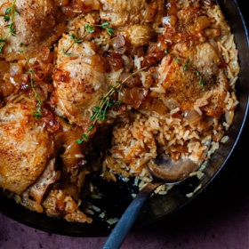

---
categories:
- 135D8DF8-5165-487A-9161-61345003AB1B
- E131025A-19E9-4C5F-99A8-75EE51F165D8
- A774024D-4AFA-4EB2-B28E-8925ACA5E85C
- 98E4F68D-11D7-4383-90FA-22C804880E1C
cook_time: 70 minutes
created: '2023-12-31 13:13:12'
difficulty: ''
hash: 9dc7c7c3fdeeb6f9e090f92f51b64578ea3f0c3bccdf475d1f8f79b625f083ed
image_url: https://i0.wp.com/smittenkitchen.com/wp-content/uploads/2023/09/chicken-rice-with-buttered-onions-11-scaled.jpg?w=1920&ssl=1
in_trash: false
is_pinned: false
on_favorites: false
on_grocery_list: false
prep_time: ''
rating: 0
scale: null
servings: 'Servings: 4 to 6'
source: smittenkitchen.com
source_url: https://smittenkitchen.com/2023/09/chicken-rice-with-buttered-onions/
total_time: ''
uid: BE67A849-7702-4BFB-8D81-8D078DE6B427
---

# Chicken Rice with Buttered Onions

## Ingredients

- 2 to 2 1/4 pounds bone-in, skin-on chicken thighs (4 to 6)
- Kosher salt and freshly ground black pepper
- 1 tablespoon olive oil
- 3 tablespoons unsalted butter, divided
- 1 1/2 pounds (3 large) yellow onions, diced into just shy of 1/2″ pieces
- Leaves stripped from a few sprigs of thyme
- 1 1/2 cups uncooked white rice, any variety
- 1/4 cup white wine (optional)
- 2 cups chicken broth and up to 1/4 cup more if needed (updated)

## Directions

Prepare the chicken: Arrange chicken skin side up on a plate and season generously on top with salt and freshly ground black pepper. We’ll get to the undersides in a minute.

Heat a large sauté pan, preferably one with a lid, over medium-high heat for one minute. Once the pan is very hot, add 1 tablespoon olive oil and 1 tablespoon butter, and heat them together for another full minute. Arrange chicken skin side down and cook until deeply brown underneath, about 4 to 5 minutes. [Don’t crowd the chicken; depending on the size of your pan, you might need to do this in two batches.] While it browns, season what is now the top side with additional salt and pepper. Once browned, flip the pieces over and brown on the second side, about another 3 to 4 minutes. Don’t skimp on the color, please. Transfer the chicken to a plate.

Prepare the buttered onions: Leave the pan on medium-high and add 2 tablespoons butter to fat and juices in it. Once melted, add the onions and season with 1 teaspoon kosher salt. Cook the onions for about 15 minutes total, or until golden throughout and darker brown at the edges, stirring every couple minutes. In the beginning, the onions are watery; once the water has cooked off and the onions begin to pick up color, I reduce the heat to medium for the remaining time. Carefully taste and season with more salt, if desired, and lots of freshly ground black pepper. Remove 1/3 cup of onions and set aside until the end.

Finish the chicken and rice: Add thyme and dried rice and cook with the onions for 1 minute. Add the wine, if using, and cook until it disappears, about 1 to 2 minutes. Scrape down the pan sides, pushing any dried rice and onions back to the bottom. Return the chicken thighs to the pan skin side up, spacing them out. Carefully pour 2 cups (updated amount) of the broth around chicken. Bring the pan to a simmer then reduce to the lowest simmer and cover. Cook rice and chicken together for 25 minutes, or until rice is tender. If rice is not tender at 25 minutes, add remaining 1/4 cup broth and return to the heat for another 5 to 10 minute4s.

To finish and serve: Off heat, rest the dish for 5 to 10 minutes before serving. Scatter with reserved buttered onions and scoop it onto plates.

Do ahead: This keeps so well. I reheat it covered in an oven-safe dish at 350 degrees for 15 to 30 minutes, until the chicken is warm. To freeze, well, I’m just going to say it: I’ll pack it ingloriously in a freezer bag and press out the extra air. Defrost in the fridge for a day, if you have time, then rewarm as written above.
