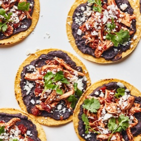

---
categories:
- 135D8DF8-5165-487A-9161-61345003AB1B
- E131025A-19E9-4C5F-99A8-75EE51F165D8
- F254E705-1305-4DF7-9238-5C500D4EF54E
- 98E4F68D-11D7-4383-90FA-22C804880E1C
cook_time: ''
created: '2020-06-17 18:24:24'
difficulty: ''
hash: b85938b51e3b08f724647d9676f09617f946232fcb58030fd082ae957a46fd58
image_url: https://assets.bonappetit.com/photos/5d8bb4cea0d8ae000830c10a/3:2/w_1880,c_limit/Basically-Chicken-Tostada.jpg
in_trash: false
is_pinned: false
on_favorites: false
on_grocery_list: false
prep_time: ''
rating: 0
scale: null
servings: '8'
source: bonappetit.com
source_url: https://www.bonappetit.com/recipe/chicken-tinga-tostadas
total_time: ''
uid: 992167C6-61C1-4CE9-8B35-DE35CE6F884A-25082-00000C8628EC3A2D
---

# Chicken Tinga Tostadas with Bacony Black Beans

## Ingredients

- 1 medium white onion
- 4 garlic cloves
- 1 (7 oz) can chipotle chiles in adobo
- 1 (15 oz) can fire-roasted tomatoes
- 2 tbsp chili powder
- 2 skin-on, bone-in chicken breasts (about 1 1/2 lb total)
- Kosher salt
- 4 oz smoked bacon
- 2 (15 oz) cans black beans
- 8 tostadas
- 4 oz queso fresco
- 3/4 cup cilantro

## Directions

First, prep the spicy tomato sauce: Peel and finely chop 1 medium white onion; set aside 1/2 cup for serving. Transfer half of remaining chopped onion to a large saucepan (you’ll use the rest of the onion for the beans). Peel and finely chop 4 garlic cloves. Transfer to saucepan. Finely chop 1 chipotle chile and transfer to saucepan. (You can store any remaining chiles individually in the freezer to use for later.)

Slide 1 of 3

Add 1 (15 oz) can fire-roasted tomatoes, 2 tbsp chili powder, and 2 tbsp adobo sauce (use 1 tbsp if you're sensitive to heat) to saucepan, stir to combine, and bring to a boil over medium-high heat. Nestle 2 skin-on, bone-in chicken breasts into mixture, reduce heat to medium-low, and bring liquid to a simmer. Cover saucepan and cook until chicken is cooked through and shreds easily with two forks, 25-35 minutes.

Meanwhile, make the beans: Slice 4 oz smoked bacon into thin strips about 1/4" wide and transfer to a large skillet. Add remaining chopped onion and cook over medium heat, stirring occasionally, until fat has rendered, bacon is crispy, and onion is browned and tender, 8-10 minutes.

Increase to medium-high and add 2 (15 oz) cans black beans and their liquid (that's right—don't drain them!). Bring to a boil and cook, stirring occasionally, until liquid is reduced slightly, about 5 minutes.

Using a potato masher (or a wooden spoon, if you're in a pinch), smash beans until almost no whole beans remain and mixture is thick, smooth, and creamy, like the consistency of sour cream. Remove from heat, taste and season with salt if necessary, and let cool slightly; the refried beans will thicken as they sit.

When chicken is finished cooking, use tongs to transfer to a plate and let cool slightly. While chicken cools, increase heat to medium-high and simmer sauce, uncovered and stirring occasionally, until it looks like a thick and chunky salsa, about 5 minutes. Let cool slightly in pan.

Remove skin from chicken breasts and separate meat from bones; discard skin and bones. Shred meat into small pieces and transfer to a medium bowl. Pour warm salsa over chicken, season with 1 1/2 tsp salt, and toss to coat.

Assemble your tostadas: Use your hands to crumble 4 oz queso fresco into small pieces (about the size of dried lentils).

Spread about 1/3 cup refried beans over 1 tostada. Top with about 1/2 cup chicken tinga.

Repeat with as many tostadas as you think you’ll eat (the separate components will keep well in the fridge). Top with queso fresco, cilantro, and reserved chopped onion.
