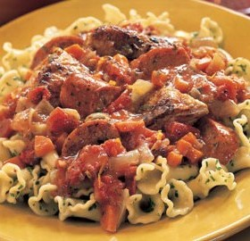

---
categories:
- 135D8DF8-5165-487A-9161-61345003AB1B
- E131025A-19E9-4C5F-99A8-75EE51F165D8
- 460F3A6B-0B87-457B-AF84-A1CE51D92D74
- 98E4F68D-11D7-4383-90FA-22C804880E1C
cook_time: ''
created: '2020-01-26 10:36:37'
difficulty: ''
hash: c3940ed94ac351b6793f8e865e8b98eeff3c49b313d89db5e8421e456e01b362
image_url: https://assets.bonappetit.com/photos/57b0831c53e63daf11a4eb1d/16:9/w_1880,c_limit/mare_chicken_and_andouille_sausage_ragu_h.jpg
in_trash: false
is_pinned: false
on_favorites: false
on_grocery_list: false
prep_time: ''
rating: 0
scale: null
servings: 6 servings
source: Bonappetit.com
source_url: https://www.bonappetit.com/recipe/chicken-and-andouille-sausage-rag
total_time: ''
uid: 6BC1F36E-F3FD-4666-9A87-9CD4E7ED3377
---

# Chicken and Andouille Sausage Ragù

## Ingredients

- 9 chicken thighs with skin and bones (about 4 pounds), well trimmed
- 2 tablespoons olive oil
- 1 pound chicken andouille sausage or other fully cooked spicy smoked sausage, cut into 1/2-inch-thick rounds
- 3 medium carrots, peeled, diced
- 2 large onions, chopped
- 1/2 cup chopped fresh marjoram (from about 2 large bunches)
- 6 garlic cloves, minced
- 1 teaspoon grated lemon peel
- 1/4 teaspoon dried crushed red pepper
- 1 cup dry white wine
- 2 14 1/2-ounce cans diced tomatoes in juice
- 2 cups low-salt chicken broth
- Campanelle Pasta with Parsley Butter (click for recipe)

## Directions

Place chicken thighs, skin side down, on work surface. Using sharp knife, cut each thigh lengthwise along each side of bone, forming 2 pieces of meat (some meat may remain on bones); reserve bones.

Heat oil in heavy large pot over medium-high heat. Sprinkle chicken and bones with salt and pepper. Working in batches, sauté in pot until brown, about 6 minutes per batch. Transfer to bowl. Add sausage to pot and sauté until brown, about 5 minutes. Using slotted spoon, transfer to bowl with chicken. Add carrots and onions to pot and sauté until onions are tender and golden, about 10 minutes. Stir in 1/4 cup marjoram, garlic, lemon peel, and crushed red pepper; sauté 2 minutes. Add wine and boil until reduced by half, about 3 minutes. Stir in tomatoes with juices and broth; bring to boil. Add chicken, bones, sausage, and any accumulated juices from bowl. Reduce heat, cover, and simmer until chicken is cooked through, about 35 minutes.

Using slotted spoon, transfer chicken and sausage to bowl; discard bones. Boil liquid in pot until reduced to 3 cups, about 20 minutes. Stir in remaining 1/4 cup marjoram. Season to taste with salt and pepper. Return chicken and sausage to pot. DO AHEAD Can be made 1 day ahead. Cool slightly. Refrigerate uncovered until cold, then cover and keep refrigerated. Rewarm over medium heat before serving. Spoon ragù over Campanelle Pasta with Parsley Butter.
