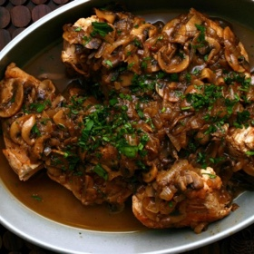

---
categories:
- 135D8DF8-5165-487A-9161-61345003AB1B
- E131025A-19E9-4C5F-99A8-75EE51F165D8
- 1C21D75E-3CF2-4B23-B04F-A9275BC1033B
- 98E4F68D-11D7-4383-90FA-22C804880E1C
cook_time: ''
created: '2022-10-10 09:27:38'
difficulty: ''
hash: c6cc57b9cd86369ae0010c3cef0c3597df5209bc41fb88c08d0e590bd3c7aa5f
image_url: https://i2.wp.com/smittenkitchen.com/wp-content/uploads//2008/03/alexs-chicken-and-mushroom-marsala.jpg?fit=750%2C500&ssl=1
in_trash: false
is_pinned: false
on_favorites: false
on_grocery_list: false
prep_time: ''
rating: 0
scale: null
servings: Serves 6
source: smittenkitchen.com
source_url: https://smittenkitchen.com/2008/03/alexs-chicken-and-mushroom-marsala/
total_time: ''
uid: 29D7C383-1C3D-4DB1-BF7D-1162F696AC96
---

# Chicken and Mushroom Marsala

## Ingredients

- 3 whole boneless chicken breasts with skin (about 2 1/2 pounds), halved (see Note)
- 1 1/2 tablespoons olive oil
- 3 1/2 tablespoons unsalted butter
- 1 onion, halved and sliced thin
- 3/4 pound mushrooms, sliced thin, any variety you like
- 1/2 cup dry Marsala
- 1 cup chicken broth
- 2 tablespoons minced fresh parsley leaves (optional, for garnish)

## Directions

Pat chicken dry and season with salt and pepper. In a large heavy skillet heat oil and 1 1/2 tablespoons butter over moderately high heat until hot but not smoking and brown chicken in 2 batches, transferring with tongs to a large plate as browned.

Discard all but 1 tablespoon fat from skillet and sauté onion and mushrooms, stirring occasionally, until liquid mushrooms give off is evaporated. Add Marsala and cook mixture, stirring, until Marsala is almost evaporated. Add broth and chicken with any juices that have accumulated on plate and simmer, turning chicken once, until cooked through, about 15 minutes. Transfer chicken with tongs to a platter.

Simmer mushroom sauce until liquid is reduced to about 1/2 cup. Remove skillet from heat and stir in remaining 2 tablespoons butter and salt and pepper to taste, stirring until butter is just incorporated. Spoon mushroom sauce around chicken and sprinkle with parsley.
