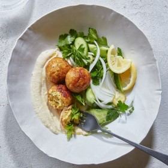

---
categories:
- 135D8DF8-5165-487A-9161-61345003AB1B
- E131025A-19E9-4C5F-99A8-75EE51F165D8
- 1C21D75E-3CF2-4B23-B04F-A9275BC1033B
- 2BBE169B-4709-4377-8F54-765FFAAD9E1A
cook_time: ''
created: '2020-01-26 10:36:14'
difficulty: ''
hash: 5ae42b07e99ffa7ff8b1895c37acafd6e79b9f0a29c08dca8b778b74c0bfc93b
image_url: https://assets.bonappetit.com/photos/5df7ec4f95932c0008b0d4f7/16:9/w_1880,c_limit/HLY-FGFP-Chicken-Rice-Meatballs-16x9.jpg
in_trash: false
is_pinned: false
on_favorites: false
on_grocery_list: false
prep_time: ''
rating: 0
scale: null
servings: 4 servings
source: Bonappetit.com
source_url: https://www.bonappetit.com/recipe/chicken-and-rice-meatballs-with-hummus
total_time: ''
uid: 297D4019-9FA9-4C2F-9B70-F8E2CA75359D
---

# Chicken and Rice Meatballs with Hummus

## Ingredients

- 6 scallions, thinly sliced
- 2 garlic cloves, finely chopped
- 1 1" piece ginger, peeled, finely chopped
- 1 lb. ground chicken
- 1½ cups cooled cooked white rice
- ¼ cup extra-virgin olive oil
- 2 tsp. hawaij, baharat, curry powder, or other spice blend
- 1 tsp. Diamond Crystal or ½ tsp. Morton kosher salt, plus more
- 1 small white onion, thinly sliced
- 4 small dill pickles, sliced
- 2 Persian cucumbers, sliced
- 2 cups parsley leaves with tender stems
- 1 Tbsp. fresh lemon juice
- Hummus and lemon wedges (for serving)

## Directions

Preheat oven to 425°. Gently mix scallions, garlic, ginger, chicken, rice, oil, hawaij, and 1 tsp. Diamond Crystal or ½ tsp. Morton kosher salt in a medium bowl (don’t overwork). Form mixture into 12 balls (about 1½" in diameter). Place on a rimmed baking sheet and bake until lightly browned and cooked through, about 15 minutes.

Toss onion, pickles, cucumbers, parsley, and lemon juice in a medium bowl to combine; season salad with salt.

Spread hummus on plates; top with meatballs and salad. Serve with lemon.
