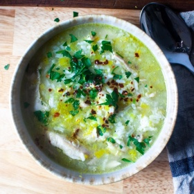

---
categories:
- 135D8DF8-5165-487A-9161-61345003AB1B
- E131025A-19E9-4C5F-99A8-75EE51F165D8
- 1A786DC7-9C26-4F71-B6F4-1B452FC14FB9
- 98E4F68D-11D7-4383-90FA-22C804880E1C
cook_time: 40 minutes
created: '2022-01-10 09:58:16'
difficulty: ''
hash: 49d5a695dfe37ad630cb891d538b85fd4ba6342a1e601ec830854121884094a3
image_url: https://i2.wp.com/smittenkitchen.com/wp-content/uploads//2020/03/chicken-leek-and-rice-soup.jpg?fit=750%2C500&ssl=1
in_trash: false
is_pinned: false
on_favorites: false
on_grocery_list: false
prep_time: ''
rating: 0
scale: null
servings: 'Servings: 4 to 6'
source: smittenkitchen.com
source_url: https://smittenkitchen.com/2020/03/chicken-leek-and-rice-soup/
total_time: ''
uid: 37F78850-8D46-4EDD-AA56-18E3D9F6F2C2
---

# Chicken, Leek, and Rice Soup

## Ingredients

- 2 tablespoons olive oil or unsalted butter
- 2 large or 3 medium leeks, halved and thinly sliced
- 1 celery rib, thinly sliced
- 1 carrot stick, thinly sliced (optional)
- 2 large garlic cloves, minced
- 4 cups chicken stock or broth, preferably homemade
- 2 cups water
- 1 pound boneless, skinless chicken thighs
- 1/2 cup long-grain white rice (I used jasmine)
- Big handful chopped fresh herbs (parsley, chives, and dill are favorites here)
- Lemon zest and juice
- Red pepper flakes (I’m using Aleppo, which is milder) or harissa

## Directions

Heat olive oil or butter over medium-high heat in a 4- to 5-quart pot. Add leeks, celery, and carrot (if using), salt, and pepper, and cook, stirring, until leeks have softened a bit, about 4 minutes. Add garlic and cook one minute more. Add broth, water, and chicken plus salt (I use 2 to 3 teaspoons of additional kosher salt for barely-salted stock) and many grinds of black pepper and bring to a boil. Reduce heat to medium-low and cover, simmering for 15 minutes, until chicken is very tender and cooked through. Remove chicken with tongs and set on a cutting board. Add rice and return the heat to a low simmer, cover with lid, and cook for 15 minutes, until rice is tender. Use two forks to shred chicken into bite-sized pieces and return to the soup to rewarm. Adjust seasonings to taste.

Ladle soup into bowls and finish with some herbs, lemon zest, red pepper flakes (or harissa), and serve with lemon wedges on the side.

## Notes

Note: Rice continues to expand in soup so the longer you have the soup sitting, the more porridge-y it will seem.
