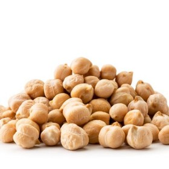

---
categories:
- A3FA97E2-41F7-4C28-8433-211311D4E130
- F0D08EC3-D9EF-4F02-A381-FF3D38660DA6
- 18EDB3A1-512C-4003-8EE4-AE58D58363B1
cook_time: ''
created: '2026-01-31 21:30:48'
difficulty: ''
hash: 1e63ce388f30710fe23f1f8c5d9450d85ae9ee6dca26e5f3468317160c20939f
image_url: null
in_trash: false
is_pinned: false
on_favorites: false
on_grocery_list: false
prep_time: ''
rating: 0
scale: null
servings: ''
source: ''
source_url: ''
total_time: ''
uid: B1F76FD8-AB19-4418-A543-63D59EB61561
---

# Chickpeas (Instant Pot)

Cooked from dried in the pot.

## Ingredients

- Chickpeas

## Directions

Water + Beans, fill water several inches above beans.

55 min on high pressure, natural release (25 min).

## Notes

Do not salt water. 50 minutes for a firmer bean.
