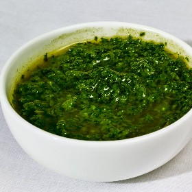

---
categories:
- A3FA97E2-41F7-4C28-8433-211311D4E130
cook_time: ''
created: '2023-07-02 15:25:59'
difficulty: ''
hash: 696aa526fb723c5b5806f2d4a5111ae8acaec5b31e8219707a16a4dd4d921dec
image_url: https://static01.nyt.com/images/2015/08/16/magazine/16eat4_chimichurri/16eat4_chimichurri-superJumbo.jpg
in_trash: false
is_pinned: false
on_favorites: false
on_grocery_list: false
prep_time: ''
rating: 1
scale: null
servings: 4 servings.
source: Cooking.nytimes.com
source_url: https://cooking.nytimes.com/recipes/1017621-chile-chimichurri
total_time: 10 min
uid: 06E336C4-825A-46CB-BF1A-6E0A09B84878
---

# Chile Chimichurri

## Ingredients

- 2 cups fresh parsley leaves
- 2 tbsp chopped fresh oregano leaves
- 1 medium jalapeño chile (more or less to taste), trimmed and halved
- 1 large garlic clove, or more to taste
- 1/2 cup extra-virgin olive oil, or more if you’d like
- Salt
- 2 tbsp sherry or red-wine vinegar

## Directions

Put the herbs, chile and garlic in a food processor or blender with about half the oil and a pinch of salt. Purée, stopping to scrape down the sides of the container if necessary and adding the rest of the oil gradually.

Add the vinegar, then a little more oil or some water if you prefer a thinner sauce. Taste, adjust the seasoning and serve right away. Or cover and refrigerate for up to a day; return to room temperature before serving.

Note For Next Time!!!! (if ever)
----
red wine vinegar is gross... try a different acid and dial it back to no more than 10% of this measurement...

## Nutritional Information

Trans Fat: 0 g
Fat: 27 g
Calories: 258
Saturated Fat: 4 g
Unsaturated Fat: 23 g
Sodium: 164 milligrams
Sugar: 0 g
Fiber: 2 g
Carbohydrate: 4 g
Protein: 1 g
