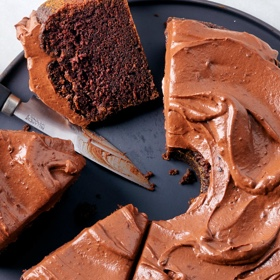

---
categories:
- 6BF378BD-8FD0-4FEF-9755-940308F0C8C7
- 60FB6093-F8C4-447B-A9A2-81A75BBCBA70
- E5311B89-BA3B-4153-9D9E-C809730BC236
- 2BBE169B-4709-4377-8F54-765FFAAD9E1A
cook_time: ''
created: '2025-11-08 18:36:51'
difficulty: ''
hash: 4230ab00734f5b5f0cd91f697b19747fc992e0c339fd58ec72652b36b096ec87
image_url: https://static01.nyt.com/images/2019/01/11/dining/ah-chocolate-dump-it-cake/merlin_147611010_cc3b9466-1485-485c-a638-f464b3cabcec-videoSixteenByNineJumbo1600.jpg
in_trash: false
is_pinned: false
on_favorites: false
on_grocery_list: false
prep_time: ''
rating: 0
scale: null
servings: 10 servings
source: cooking.nytimes.com
source_url: https://cooking.nytimes.com/recipes/9404-chocolate-dump-it-cake
total_time: 1 hr 45 min
uid: BAE2E02A-E9DF-4D64-BCB3-4840B93CFBE9
---

# Chocolate Dump-It Cake

## Ingredients

- 2 cups sugar
- 4 ounces unsweetened chocolate
- 1 stick unsalted butter, plus more for greasing the pan
- 2 cups all-purpose flour, plus more for dusting the pan
- 2 teaspoons baking soda
- 1 teaspoon baking powder
- 1 teaspoon salt
- 1 cup milk
- 1 teaspoon cider vinegar
- 2 eggs
- 1 teaspoon vanilla
- 1 1/2 cups Nestle's semisweet-chocolate chips
- 1 1/2 cups sour cream, at room temperature

## Directions

Preheat the oven to 375 degrees and place a baking sheet on the lowest rack to catch any drips as the cake bakes on the middle rack. In a 2- to 3-quart pot, mix together the sugar, unsweetened chocolate, butter and 1 cup of water. Place over medium heat and stir occasionally until all of the ingredients are melted and blended. Remove from the heat and let cool slightly.

Meanwhile, sift together the flour, baking soda, baking powder and salt. In a small bowl, stir together the milk and vinegar. Grease and flour a 9-inch tube pan (Tip: Be meticulous, and really work the butter and flour into the crevices of the pan. This is a moist cake, so it really needs a well-prepared pan to keep it from sticking).

When the chocolate in the pot has cooled a bit, whisk in the milk mixture and eggs. In several additions, and without overmixing, whisk in the dry ingredients. When the mixture is smooth, add the vanilla and whisk once or twice to blend. Pour the batter into the tube pan and bake on the middle rack until a skewer inserted in the center comes out clean, about 30 to 35 minutes. Let the cake cool for 10 minutes, then remove from the pan and cool on a rack. (This can be tricky -- if someone is around to help, enlist him.) Let cool completely.

Meanwhile, melt the chocolate chips in a double boiler, then let cool to room temperature. Stir in the sour cream, 1/4 cup at a time, until the mixture is smooth.

When the cake is cool, you may frost it as is or cut it in half so that you have 2 layers. There will be extra icing whether you have 1 or 2 layers. My mother always uses it to make flowers on top. She makes a small rosette, or button, then uses toasted slices of almond as the petals, pushing them in around the base of the rosette.

## Nutritional Information

Trans Fat: 0 grams
Fat: 31 grams
Calories: 621
Saturated Fat: 18 grams
Unsaturated Fat: 11 grams
Sodium: 426 milligrams
Sugar: 57 grams
Fiber: 4 grams
Carbohydrate: 82 grams
Protein: 8 grams
