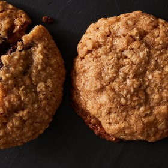

---
categories:
- 6BF378BD-8FD0-4FEF-9755-940308F0C8C7
- 60FB6093-F8C4-447B-A9A2-81A75BBCBA70
- E5311B89-BA3B-4153-9D9E-C809730BC236
- 2BBE169B-4709-4377-8F54-765FFAAD9E1A
cook_time: 1 hour
created: '2020-12-20 15:32:35'
difficulty: ''
hash: f5819d3041330cedb1fb8f4dd2ec1d3efbaf1871d8ea9f643f8e570565b1f87a
image_url: https://static01.nyt.com/images/2020/12/14/dining/ss-chocolate-filled-oatmeal-cookies/merlin_178579281_446eb888-c84f-44b4-bb31-b2e5bc515cc7-articleLarge.jpg
in_trash: false
is_pinned: false
on_favorites: false
on_grocery_list: false
prep_time: ''
rating: 0
scale: null
servings: Yield 12 cookies
source: Cooking.nytimes.com
source_url: https://cooking.nytimes.com/recipes/1021516-chocolate-stuffed-oatmeal-cookies?smid=ck-recipe-android-share
total_time: ''
uid: E0CBD0F6-C066-4075-82E9-0FDE63510BC7
---

# Chocolate-Stuffed Oatmeal Cookies

## Ingredients

- FOR THE COOKIE DOUGH:
- 1/2 cup (115 g) unsalted butter (1 stick), at room temperature
- 3/4 cup (165 g) dark brown sugar
- 1/2 cup (100 g) granulated sugar
- 1 large egg
- 2 tsp pure vanilla extract
- 1 1/2 cups (150 g) quick-cooking or old-fashioned oats
- 1 cup (130 g) all-purpose flour
- 1/2 tsp baking powder
- 1/2 tsp ground cinnamon
- 1/2 tsp kosher salt
- FOR THE FILLING:
- 3 tbsp heavy cream
- 3/4 cup (115 g) finely chopped semisweet or bittersweet chocolate
- 1/2 tsp pure vanilla extract
- A generous pinch kosher salt

## Directions

Prepare the cookie dough: In the bowl of a food processor, combine the butter and both sugars and process until combined. Add the egg and vanilla and pulse to combine, scraping down the sides of the bowl with a rubber spatula as needed.

Add the oats, flour, baking powder, cinnamon and salt, and process until combined and the oats have broken down a bit, scraping down the sides of the bowl occasionally.

Transfer the dough to a large piece of plastic wrap and use the sides of the plastic to shape it into a flat, 8-inch square that is about 1/2-inch thick. Chill until firm, at least 2 hours.

Prepare the filling: Heat the cream in a small saucepan or in a bowl in the microwave until hot. (Be careful: Cream loves to boil over.) Add the chocolate, vanilla and salt to the hot cream and let stand 2 minutes, then stir until smooth and uniform. (If not fully smooth, carefully heat a bit longer on the stovetop, stirring until smooth, or heat in the microwave in 5-second spurts, stirring after each blast, until smooth.) Transfer the filling to a large piece of plastic wrap and use the sides of the plastic to shape it into a 4-6 inch square. Chill until firm, at least 2 hours.

Heat the oven to 375°F. Line two rimmed baking sheets with parchment paper.

Cut the cookie dough into 24 equal pieces. Cut the chocolate filling into 12 equal pieces. (It’s OK if the chocolate breaks a bit; just make sure you have 12 equal piles.) Flatten one piece of cookie dough slightly. Set a piece of chocolate filling into the center. Flatten another piece of cookie dough and set it on top of the chocolate filling. Use your hands to shape the cookie dough around the filling and then roll it into a neat ball. Repeat with the rest of the dough and filling.

Set 6 dough balls onto one of the prepared sheets. Bake until set and relatively flat, with just-golden edges, 14-16 minutes. Let cool for 5 minutes on the baking sheet, then transfer to a rack to cool completely. Repeat with the remaining cookies on the other baking sheet. Serve cookies warm or at room temperature.
