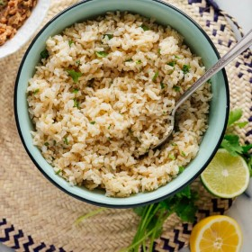

---
categories:
- A3FA97E2-41F7-4C28-8433-211311D4E130
cook_time: ''
created: '2020-01-26 10:48:24'
difficulty: ''
hash: 00c98a4650d22a6a77696822394ec6b2c2c1206141c4ea04682bc2b60e967be8
image_url: https://cookieandkate.com/images/2019/06/cilantro-lime-brown-rice-recipe-2-768x1154.jpg
in_trash: false
is_pinned: false
on_favorites: false
on_grocery_list: false
prep_time: ''
rating: 0
scale: null
servings: ''
source: Cookieandkate.com
source_url: https://cookieandkate.com/cilantro-lime-brown-rice-recipe/
total_time: ''
uid: FECCE826-B8D3-421D-A83C-94500243B345
---

# Cilantro Lime Brown Rice

## Ingredients

- 1 1/2 cups long-grain brown rice or brown basmati rice, rinsed
- 1 bay leaf
- 1/4 cup chopped fresh cilantro
- 2 tbsp lime juice (from about 1 lime)*
- 1 1/2 tsp lemon juice (from 1 small lemon)
- 1 tbsp plus 1 tsp extra-virgin olive oil
- 1/2 tsp fine sea salt

## Directions

Bring a large pot of water to boil over high heat. Pour in the rinsed rice and drop in the bay leaf. Give the mixture a brief stir and let it boil for 30 minutes, reducing the heat if necessary to prevent overflow.

Drain the rice, return it to the pot, cover, and let it rest for 10 minutes off the heat. Discard the bay leaf and fluff the rice with a fork.

Add the cilantro, lime juice, lemon juice, olive oil, and salt and stir to combine. Taste and add additional salt if necessary (I usually add an extra 1/4 tsp). Cover until you’re ready to serve.

Leftover rice will keep well in the refrigerator, covered, for up to 5 days.
