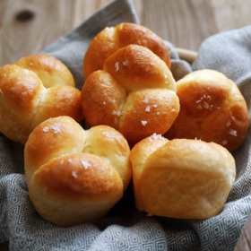

---
categories:
- 9B3E8F54-7F9D-4782-919F-ACC9A0850C87
- 60FB6093-F8C4-447B-A9A2-81A75BBCBA70
- E5311B89-BA3B-4153-9D9E-C809730BC236
- 2BBE169B-4709-4377-8F54-765FFAAD9E1A
cook_time: ''
created: '2023-11-18 11:23:31'
difficulty: ''
hash: 392e47e30fbd910c22ea3b54764d21906e528d8055480d346ca6ac484392fa35
image_url: https://static01.nyt.com/images/2017/12/12/dining/12COOKING-CLOVERLEAFROLL2/12COOKING-CLOVERLEAFROLL2-square640.jpg
in_trash: false
is_pinned: false
on_favorites: false
on_grocery_list: false
prep_time: ''
rating: 0
scale: ''
servings: 12 servings
source: cooking.nytimes.com
source_url: https://cooking.nytimes.com/recipes/1019093-cloverleaf-rolls
total_time: 40 min
uid: 24106B5F-027E-45E8-82CC-C08791121788
---

# Cloverleaf Rolls

## Ingredients

- 7g active dry yeast
- 2 tbsp granulated sugar
- 1/2 cup whole milk, warmed to 105 to 110 degrees
- 85 grams unsalted butter, plus more for the pan
- 255 grams all-purpose flour
- 1 tsp kosher salt
- 1 large egg

## Directions

Stir the yeast and 1 teaspoon of the sugar into the milk. Set aside until foamy, about 5 minutes. Melt 4 tablespoons of the butter.

Meanwhile, in the bowl of a stand mixer with the dough hook attached, combine the remaining sugar, flour and salt. With the mixer on low, add the yeast mixture and the egg and knead until the dry ingredients have been incorporated (you may have to help it along at first with a spatula) and the dough is smooth, about 5 to 10 minutes. Carefully add the melted butter (the dough will slosh around in the butter for a few minutes, but will eventually absorb it all) and continue to knead the dough until smooth, increasing the speed to medium, another 5 to 10 minutes. The dough will be shiny and elastic; if it’s at all sticky, scrape down the sides of the bowl and gather the dough into a neat ball (no need to add extra flour). Cover the bowl with plastic and set aside to rise in a warm place until doubled, about 1 to 2 hours.

Butter a standard 12-cup muffin tin. Gently tip the dough out onto a work surface. You shouldn’t need flour at this point. Divide the dough into 12 equal pieces. Work with one piece at a time and keep the other pieces covered. Divide each piece into 3 equal pieces, roll each piece into a tight ball and place into one cup. Repeat with the remaining dough. Cover the tray lightly with plastic wrap and set aside to double again, about 45 minutes to 1 hour. The dough should look puffy and spring back slowly when pressed gently.

Heat the oven to 375 degrees. Melt the remaining 2 tablespoons butter. Remove the plastic wrap and without deflating the dough, gently brush the rolls with butter. Bake until puffed and golden, about 10 to 12 minutes. Remove from the oven and brush with more butter and sprinkle with salt. Serve warm.

## Nutritional Information

Trans Fat: 0 grams
Fat: 7 grams
Calories: 150
Saturated Fat: 4 grams
Unsaturated Fat: 2 grams
Sodium: 106 milligrams
Sugar: 3 grams
Fiber: 1 gram
Carbohydrate: 19 grams
Protein: 3 grams
