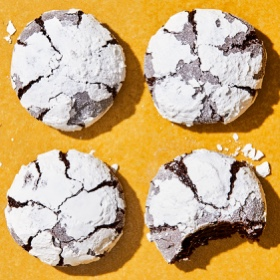

---
categories:
- 6BF378BD-8FD0-4FEF-9755-940308F0C8C7
- 60FB6093-F8C4-447B-A9A2-81A75BBCBA70
- E5311B89-BA3B-4153-9D9E-C809730BC236
- 2BBE169B-4709-4377-8F54-765FFAAD9E1A
cook_time: ''
created: '2021-12-17 08:55:49'
difficulty: ''
hash: c289f553b2e32bf010bdeb30d6f9d8507574378babe1e8e4dbb91f5f815c28c8
image_url: https://assets.bonappetit.com/photos/6192c058797bf47162ab923a/1:1/w_2560%2Cc_limit/Cocoa-Coffee-Almond-Cookies.jpg
in_trash: false
is_pinned: false
on_favorites: false
on_grocery_list: false
prep_time: ''
rating: 0
scale: null
servings: About 12
source: bonappetit.com
source_url: https://www.bonappetit.com/recipe/cocoa-coffee-almond-cookies
total_time: ''
uid: 41AA0B60-12A6-4054-8C07-9BFF2667B4A6
---

# Cocoa-Coffee Almond Cookies

## Ingredients

- 6 1/2 oz almond paste (about 3/4 cup)
- 1 cup (200 g) granulated sugar
- 1/3 cup (30 g) unsweetened Dutch-process cocoa powder
- 2 tsp Diamond Crystal or 1 1/4 tsp Morton kosher salt
- 2 tsp instant espresso powder
- 2 large egg whites
- 2/3 cup (84 g) all-purpose flour
- 3/4 cup (83 g) powdered sugar, sifted

## Directions

Pulse almond paste in a food processor until broken up into small pieces. Add granulated sugar, cocoa powder, salt, and espresso powder and pulse, scraping down sides of bowl as needed, until mixture is well combined and mostly powdery with a few small clumps. Add egg whites and process until smooth, about 1 minute. Pulse in flour until just combined.

Transfer dough to a medium bowl; fold in any dry spots with a rubber spatula if needed. Cover and chill at least 1 hour.

Place racks in upper and lower thirds of oven; preheat to 350°F. Put powdered sugar in a shallow bowl. Using a #30 cookie scoop (about 2 tbsp) and working one at a time, scoop out portions of dough and roll into balls (you should have about 12). Working quickly, roll balls in powdered sugar to coat. Divide between 2 parchment-lined baking sheets, spacing about 3" apart.

Bake cookies, rotating baking sheets top to bottom and front to back halfway through, just until puffed and cracked and edges are set (cookies will look slightly underbaked between the cracks), 12-14 minutes. Let cool on baking sheets.Do ahead: Dough can be made 3 days ahead; cover and chill. Cookies can be made 4 days ahead; store airtight at room temperature.
