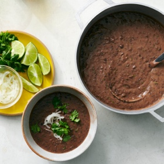

---
categories:
- 135D8DF8-5165-487A-9161-61345003AB1B
- F0D08EC3-D9EF-4F02-A381-FF3D38660DA6
- 1A786DC7-9C26-4F71-B6F4-1B452FC14FB9
- 98E4F68D-11D7-4383-90FA-22C804880E1C
cook_time: 20 min
created: '2024-03-31 10:27:55'
difficulty: ''
hash: 4e7b3c0c6c830da1bf0d31fd83fd44464df161add28c71ec1ddabd5f9917c13e
image_url: https://static01.nyt.com/images/2024/01/24/multimedia/24BIG-APPETITE-COCONUTMILKrex3-qphm/24BIG-APPETITE-COCONUTMILKrex3-qphm-square640.jpg
in_trash: false
is_pinned: false
on_favorites: false
on_grocery_list: false
prep_time: 10 min
rating: 0
scale: null
servings: 4 servings
source: cooking.nytimes.com
source_url: https://cooking.nytimes.com/recipes/1025039-coconut-black-bean-soup
total_time: 35 min
uid: 7968834E-3228-4F83-BFEA-43F09C59C281
---

# Coconut Black Bean Soup

## Ingredients

- 1 large white onion, peeled
- 2 limes, 1 halved and 1 cut into wedges
- 1 3/4 tsp kosher salt (Diamond Crystal or use 3/4 tsp Morton), plus more to taste
- 1 tbsp extra-virgin olive oil
- 4 garlic cloves, minced
- 1 jalapeño, seeded if desired and minced
- 1 bunch cilantro, stems and leaves separated
- 1 tbsp tomato paste
- 1 tsp cumin seeds
- 1/2 tsp freshly ground black pepper
- 3 (15.5 oz) cans black beans, drained
- 1 (13.5 oz) can full-fat coconut milk
- 1 cup vegetable or chicken stock, plus more if needed

## Directions

Cut the white onion in half lengthwise and then cut lengthwise again into quarters. Thinly slice one quarter of the onion. Add slices to a small bowl and stir in the juice of 1/2 lime and 1/4 tsp salt. Set aside for serving. Dice the remaining onion and reserve.

Heat a large soup pot or Dutch oven over medium-high. Once hot, add the oil. Add the diced onion and cook until tender and golden at the edges, 3-5 minutes. Stir in the garlic and cook for 1 minute or until fragrant.

Stir in the jalapeño. Mince 1/4 cup cilantro stems and add to the pan. Cook until the jalapeño and cilantro stems are tender, about 2 minutes. Stir in the tomato paste, cumin seeds, black pepper and remaining 1 1/2 tsp salt. Cook for 1-2 minutes, until the tomato paste darkens.

Add in the black beans, coconut milk and stock. Bring to a boil and lower heat to a simmer. Simmer for 15-20 minutes, or until the mixture is thick.

Use an immersion blender or blender to purée the soup until half-smooth and still a little chunky. Add more stock if you want a brothier soup.

Stir in the juice of the remaining lime half and 1/2 cup of chopped cilantro leaves. Taste and add more salt and lime juice as needed. Serve topped with the pickled onions and more chopped cilantro, and with lime wedges alongside.

## Nutritional Information

Trans Fat: 0 g
Fat: 26 g
Calories: 579
Saturated Fat: 19 g
Unsaturated Fat: 5 g
Sodium: 1351 milligrams
Sugar: 5 g
Fiber: 25 g
Carbohydrate: 69 g
Protein: 25 g
