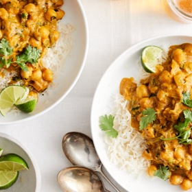

---
categories:
- 135D8DF8-5165-487A-9161-61345003AB1B
- F0D08EC3-D9EF-4F02-A381-FF3D38660DA6
- 641901A6-C962-46DC-B418-1C19B51409EF
- 98E4F68D-11D7-4383-90FA-22C804880E1C
cook_time: ''
created: '2023-06-11 11:37:00'
difficulty: ''
hash: a94eb2fb93fa8748960a7d3ab2c906699e282992a50fa1e1f6dd3bb353882310
image_url: https://static01.nyt.com/images/2019/09/25/dining/20canrex2/merlin_160763166_1a6f5c09-3b72-48bb-8f78-3bdbc5d752f2-videoSixteenByNineJumbo1600.jpg
in_trash: false
is_pinned: false
on_favorites: false
on_grocery_list: false
prep_time: ''
rating: 0
scale: null
servings: 4 to 6 servings
source: cooking.nytimes.com
source_url: https://cooking.nytimes.com/recipes/1020463-coconut-curry-chickpeas-with-pumpkin-and-lime
total_time: 30 min
uid: EB7231BF-DA72-43CE-B996-118B3C80BD3B
---

# Coconut Curry Chickpeas with Pumpkin and Lime

## Ingredients

- 3 tablespoons neutral oil, such as sunflower or canola
- 1 large onion, chopped
- 2 jalapeños, seeded or not, thinly sliced
- 1 bay leaf
- 1 knob ginger (about 1 inch), minced
- 4 garlic cloves, minced
- 1 1/2 teaspoons garam masala
- 1 teaspoon ground cumin
- 1/2 teaspoon ground turmeric
- 2 (15-ounce) cans chickpeas, rinsed
- 1 (13.5-ounce) can coconut milk (do not use light coconut milk)
- 1 (13.5-ounce) can pumpkin purée
- 1 1/2 teaspoons fine sea salt, more as needed
- 3/4 cup chopped cilantro, more for serving
- 2 to 3 tablespoons fresh lime juice, plus wedges for serving
- Cooked rice or couscous, for serving (optional)

## Directions

Heat oil in a large skillet over medium-high heat. Stir in onion, jalapeño and bay leaf. Cook, stirring occasionally, until onion is golden on the edges, about 8 minutes.

Add ginger and garlic and cook until fragrant, about 2 minutes, stirring frequently. Stir in garam masala, cumin and turmeric; cook for an additional 30 seconds.

Stir in chickpeas, coconut milk, pumpkin, 1/2 cup water and 1 1/2 teaspoons salt. Bring to a simmer and continue to simmer for 10 minutes, stirring occasionally, to let the flavors meld. (Add more water if it starts to look too thick.) Stir in cilantro and lime juice to taste. Taste and add more salt if necessary.

Serve over rice or couscous if you like, and top with more cilantro and lime wedges on the side.

## Nutritional Information

Trans Fat: 0 grams
Fat: 25 grams
Calories: 472
Saturated Fat: 13 grams
Unsaturated Fat: 9 grams
Sodium: 822 milligrams
Sugar: 9 grams
Fiber: 12 grams
Carbohydrate: 53 grams
Protein: 14 grams
