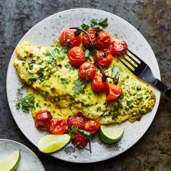

---
categories:
- 135D8DF8-5165-487A-9161-61345003AB1B
- 0E6E410A-45EC-4274-98C8-2190B87DB54A
- 1C21D75E-3CF2-4B23-B04F-A9275BC1033B
- 2BBE169B-4709-4377-8F54-765FFAAD9E1A
cook_time: ''
created: '2023-01-08 09:50:35'
difficulty: ''
hash: d3b85578466a18ac84a3ed6267e8413ed2f2b0eafdacfdb55e85b095f4892e70
image_url: https://static01.nyt.com/images/2021/04/28/dining/coconutfishrex/merlin_186997626_6bf4dc0b-2582-406b-b4ca-8a64ca49c825-articleLarge.jpg
in_trash: false
is_pinned: false
on_favorites: false
on_grocery_list: false
prep_time: ''
rating: 0
scale: null
servings: 4 servings
source: cooking.nytimes.com
source_url: https://cooking.nytimes.com/recipes/1022129-coconut-fish-and-tomato-bake
total_time: 35 min
uid: 6EF78987-CA6B-408D-916C-83F6149D1921
---

# Coconut Fish and Tomato Bake

## Ingredients

- 3/4 cup unsweetened coconut milk
- 1 (1-inch) piece fresh ginger, scrubbed and finely grated
- 1 garlic clove, finely grated
- 1/2 teaspoon ground turmeric
- 1/2 teaspoon red-pepper flakes
- 1 tablespoon honey
- Kosher salt
- 2 limes
- 1/2 cup chopped cilantro
- 4 (6-ounce) fish fillets, such as snapper, flounder, haddock, striped bass, fluke, sablefish or salmon, skin on or off
- 2 pints cherry or grape tomatoes
- 3 tablespoons olive oil
- basmati or jasmine rice, for serving

## Directions

In a large bowl, whisk together the coconut milk, ginger, garlic, turmeric, red-pepper flakes, honey and 1 teaspoon salt.

Zest and juice 1 lime directly into the coconut milk mixture. Stir in 1/4 cup chopped cilantro. Add the fish fillets and turn to coat. Marinate in the refrigerator for 15 to 30 minutes.

Meanwhile, adjust an oven rack to the lower-middle position. Arrange another rack in the position closest to the broiler heat source. Heat oven to 425 degrees.

Place the tomatoes on a large sheet pan. Drizzle with 2 tablespoons olive oil, season with salt and toss to coat. Place the marinated fish between the tomatoes and spoon all the marinade from the bowl over the fish. Drizzle 1 tablespoon of oil over the fish. Transfer the pan to the lower-middle rack and roast until the surface of the fish is opaque but the center is not cooked through, 8 to 10 minutes, depending on thickness of the fish. The fish should not flake easily with a fork. Remove the pan from the oven and heat the broiler to high.

Move the pan to the broiler and finish cooking, rotating the pan once, until the fish is tender and the tomatoes are just beginning to brown in spots, 5 to 6 minutes, depending on thickness of the fish. Slice the remaining lime into wedges.

Divide the tomatoes and fish among dishes and tip the pan juices over the fish. Garnish with the remaining 1/4 cup cilantro and serve with lime wedges for squeezing.
