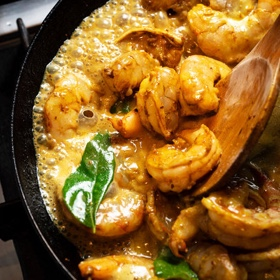

---
categories:
- 135D8DF8-5165-487A-9161-61345003AB1B
- 74D19AD7-7FB6-416E-B539-74DCDC2A820A
- 641901A6-C962-46DC-B418-1C19B51409EF
- 98E4F68D-11D7-4383-90FA-22C804880E1C
cook_time: 40 minutes
created: '2021-03-02 08:14:56'
difficulty: ''
hash: bfbd7abb279ab49a1eb2324354239e10f882c6c59b285480967afb699b0de066
image_url: https://static01.nyt.com/images/2018/06/20/dining/20kitchen1/20kitchen1-articleLarge.jpg
in_trash: false
is_pinned: false
on_favorites: false
on_grocery_list: false
prep_time: ''
rating: 0
scale: null
servings: Yield 4 servings
source: cooking.nytimes.com
source_url: https://cooking.nytimes.com/recipes/1019365-coconut-shrimp-curry-with-mushrooms?smid=ck-recipe-iOS-share
total_time: ''
uid: C735107C-8A7B-478F-B100-A7550CC1E9E4-9653-000002C093679F20
---

# Coconut Shrimp Curry with Mushrooms

## Ingredients

- 1 pound medium shrimp, peeled and deveined
- Salt and pepper
- 1 teaspoon grated ginger
- 1 teaspoon grated garlic
- 1 teaspoon turmeric
- ½ teaspoon coriander seeds, toasted and ground
- ½ teaspoon cumin seeds, toasted and ground
- 1 tablespoon tamarind paste
- 1 serrano chile, finely diced
- Pinch of cayenne
- 2 tablespoons coconut oil
- A few fresh curry leaves (optional)
- 6 ounces mushrooms, chopped
- 2 cups coconut milk, fresh or canned
- A few mint leaves and cilantro leaves, for garnish
- Lime wedges, for garnish

## Directions

Put shrimp in a medium bowl, and season generously with salt and pepper. Add ginger, garlic, turmeric, coriander, cumin, tamarind paste, serrano chile and cayenne, and mix to coat well. Leave to marinate for 5 to 10 minutes.

Heat coconut oil in a wide skillet over medium-high heat. Add curry leaves, if using, and let them sputter, then add mushrooms and stir-fry gently for about 1 minute. Add shrimp and cook, stirring for about 1 to 2 more minutes until shrimp have turned pink and mushrooms have softened.

Add coconut milk and simmer for about 1 minute. Taste sauce and adjust seasoning. Transfer to a serving dish, garnish with mint and cilantro and serve, with lime wedges on the side.

## Nutritional Information

Trans Fat: 0 grams
Fat: 32 grams
Calories: 384
Saturated Fat: 28 grams
Unsaturated Fat: 3 grams
Sodium: 660 milligrams
Sugar: 2 grams
Fiber: 1 gram
Carbohydrate: 9 grams
Protein: 19 grams
