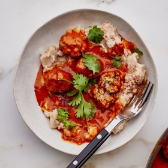

---
categories:
- 135D8DF8-5165-487A-9161-61345003AB1B
- DACC7E83-9563-43BB-A342-86C5AE800BA7
- 7CD3F8E9-6459-40C0-8802-20549A6F50EC
- 2BBE169B-4709-4377-8F54-765FFAAD9E1A
cook_time: ''
created: '2021-11-29 15:10:57'
difficulty: ''
hash: b9572b79acbc9c7c38f2113aa2cd2f847e4e6895846825da68267d54a806fba3
image_url: https://assets.bonappetit.com/photos/6196bd986bfa9b6cf706cd1c/1:1/w_2560%2Cc_limit/Coconut-Harissa%2520Meatballs.jpg
in_trash: false
is_pinned: false
on_favorites: false
on_grocery_list: false
prep_time: ''
rating: 0
scale: null
servings: 4 servings
source: bonappetit.com
source_url: https://www.bonappetit.com/recipe/coconut-harissa-meatballs
total_time: ''
uid: BB7AA5B1-6093-482A-86AA-B09C9E2BEAC1
---

# Coconut-Harissa Meatballs

## Ingredients

- 2 medium shallots
- 4 garlic cloves
- 1 tsp. garam masala
- ½ cup finely chopped cilantro, plus leaves for serving
- 2 tsp. Diamond Crystal or 1 tsp. Morton kosher salt, divided, plus more
- Freshly ground black pepper
- 1 lb. ground pork
- 1 Tbsp. plus ¼ cup refined coconut oil, room temperature
- ⅓ cup harissa paste
- 1 13.5-oz. can unsweetened coconut milk
- 2 15-oz. cans white beans, rinsed
- ½ tsp. sumac, plus more for serving

## Directions

Finely chop shallots and garlic. Combine garam masala, half of the shallots, half of the garlic, ½ cup cilantro, and 1 tsp. Diamond Crystal or ½ tsp. Morton kosher salt in a large bowl; season with pepper. Add pork and mix gently until just combined. Divide into 12 pieces and roll into balls.

Heat 1 Tbsp. oil in a large skillet over medium-high. Cook meatballs, turning occasionally, until browned in spots, 5–8 minutes. Transfer to a plate.

Reduce heat to medium; cook remaining shallots and garlic in skillet, stirring often, until garlic is softened, about 2 minutes. Stir in harissa paste, coconut milk, and 1 tsp. Diamond Crystal or ½ tsp. Morton kosher salt; season with pepper. Bring to a simmer, reduce heat to medium-low, and cook until slightly thickened, 6–8 minutes.

Nestle meatballs into sauce; cover and cook 10 minutes. Turn meatballs over; cook, uncovered, occasionally spooning sauce over, until sauce is about the consistency of marinara, 8–10 minutes.

Meanwhile, heat remaining ¼ cup oil in a medium saucepan over medium-high. Add beans and ½ tsp. sumac; season with salt and pepper. Cook, stirring and mashing beans and adding up to ¼ cup water a little at a time to loosen if needed, until heated through and almost completely mashed, about 3 minutes.

Divide beans among plates; top with meatballs and sauce. Scatter cilantro leaves and sumac over.
