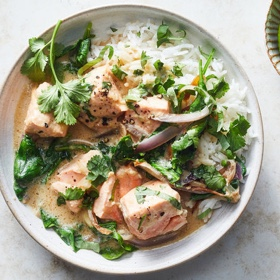

---
categories:
- 135D8DF8-5165-487A-9161-61345003AB1B
- 0E6E410A-45EC-4274-98C8-2190B87DB54A
- 641901A6-C962-46DC-B418-1C19B51409EF
- 98E4F68D-11D7-4383-90FA-22C804880E1C
cook_time: 25 minutes
created: '2020-11-15 12:15:36'
difficulty: ''
hash: d2e3f6c78a4309287545494461ab8c1c7f6fcbb6a8a4cbd13fcac69fd7f83690
image_url: https://static01.nyt.com/images/2019/02/20/dining/kc-miso-salmon-coconut-curry/merlin_150673143_c1eaa896-8f16-4688-9e2f-1de30b42c54c-articleLarge.jpg
in_trash: false
is_pinned: false
on_favorites: false
on_grocery_list: false
prep_time: ''
rating: 0
scale: ''
servings: Yield 4 servings
source: cooking.nytimes.com
source_url: https://cooking.nytimes.com/recipes/1020045-coconut-miso-salmon-curry
total_time: ''
uid: 9C9F5AB1-9531-48C7-8F3B-7A5D71BF69B8-13802-0000087C359A61AA
---

# Coconut-Miso Salmon Curry

## Ingredients

- 2 tbsp safflower or canola oil
- 1 medium red onion, halved and sliced 1/2-inch thick (about 2 cups)
- 1 (1-inch) piece fresh ginger, minced (about 2 tbsp)
- 3 garlic cloves, thinly sliced
- Kosher salt and black pepper
- 1/4 cup white miso
- 1/2 cup unsweetened, full-fat canned coconut milk
- 1 (1 1/2-lb) salmon fillet, cut into 2-inch pieces
- 5 oz baby spinach (about 5 packed cups)
- 1 tbsp fresh lime juice, plus lime wedges for serving
- Steamed rice, such as jasmine or basmati, for serving
- 1/4 cup chopped fresh basil
- 1/4 cup chopped fresh cilantro

## Directions

In a large pot, heat 2 tbsp oil over medium. Add onion, ginger and garlic and season with salt and pepper. Cook, stirring occasionally, until softened, about 3 minutes. Add miso and cook, stirring frequently, until miso is lightly caramelized, about 2 minutes.

Add coconut milk and 3 cups water and bring to a boil over high heat. Cook until liquid is slightly reduced, about 5 minutes. Stir in salmon, reduce the heat to medium-low and simmer gently until just cooked through, about 5 minutes. Turn off heat and stir in spinach and lime juice.

Divide rice among bowls. Top with salmon curry, basil and cilantro. Serve with lime wedges for squeezing on top.

## Nutritional Information

Trans Fat: 0 g
Fat: 41 g
Calories: 577
Saturated Fat: 12 g
Unsaturated Fat: 24 g
Sodium: 761 milligrams
Sugar: 4 g
Fiber: 3 g
Carbohydrate: 15 g
Protein: 39 g
