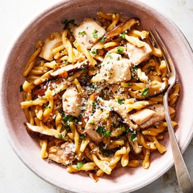

---
categories:
- 135D8DF8-5165-487A-9161-61345003AB1B
- E131025A-19E9-4C5F-99A8-75EE51F165D8
- 460F3A6B-0B87-457B-AF84-A1CE51D92D74
- 98E4F68D-11D7-4383-90FA-22C804880E1C
cook_time: 45 minutes
created: '2020-02-20 19:31:52'
difficulty: ''
hash: ef225af7efc769a3ea7c2d62602bdb6c19ac773d3ef14b503f942ba81990d827
image_url: https://static01.nyt.com/images/2018/12/01/dining/mb-pasta-with-chicken-and-mushrooms/merlin_147141321_b4c21206-fd33-4da0-a0d3-05faa52589f5-articleLarge.jpg
in_trash: false
is_pinned: false
on_favorites: false
on_grocery_list: false
prep_time: ''
rating: 0
scale: null
servings: Yield 4 servings
source: cooking.nytimes.com
source_url: https://cooking.nytimes.com/recipes/1012898-creamy-one-pot-pasta-with-chicken-and-mushrooms
total_time: ''
uid: 3CA13949-A4C2-4BB9-9279-D2BBCCE06FEE-27939-0000158A731CE9BB
---

# Creamy One-Pot Pasta with Chicken and Mushrooms

## Ingredients

- 2 tablespoons olive oil, more as needed
- 1 shallot or small onion, chopped
- 1 tablespoon minced garlic
- 2 cups crimini, shiitake or button mushrooms, cleaned, trimmed and sliced
- ½ pound cut pasta like gemelli or penne, or long pasta broken into bits
- Salt and freshly ground black pepper
- ½ cup dry white wine or water
- 3 to 4 cups chicken or vegetable stock
- 2 boneless chicken thighs, diced
- Chopped fresh parsley, optional
- Freshly grated Parmesan, optional

## Directions

Put 2 tablespoons olive oil in a large, deep skillet over medium heat. When hot, add shallot, garlic and mushrooms. Cook, stirring occasionally, until mushrooms soften and begin to brown on edges, about 10 minutes. Add pasta and cook, stirring occasionally, until it is glossy and coated with oil, 2 to 3 minutes. Add a little salt and pepper, then wine. Stir and let liquid bubble away.

Ladle stock into skillet 1/2 cup or so at a time, stirring after each addition and every minute or so. When liquid is just about evaporated, add more. Mixture should be neither soupy nor dry. Keep heat at medium and stir frequently.

Begin tasting pasta 10 minutes after you add it; you want it to be tender but with a tiny bit of crunch. When pasta is about 3 to 4 minutes away from being done, add chicken and stir to combine. Continue to cook until chicken is done — it will be white on inside when cut — and pasta is how you like it. Taste, adjust seasoning, garnish with parsley and Parmesan if using, and serve.
