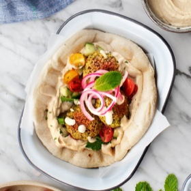

---
categories:
- 135D8DF8-5165-487A-9161-61345003AB1B
- F0D08EC3-D9EF-4F02-A381-FF3D38660DA6
- 1C21D75E-3CF2-4B23-B04F-A9275BC1033B
- 2BBE169B-4709-4377-8F54-765FFAAD9E1A
cook_time: 25 mins
created: '2020-06-04 12:02:56'
difficulty: ''
hash: 415836235495c6af24d0cfb556565624dff2ff911f8becc8e6d3378affb072c9
image_url: https://cdn.loveandlemons.com/wp-content/uploads/2019/09/falafel-580x862.jpg
in_trash: false
is_pinned: false
on_favorites: false
on_grocery_list: false
prep_time: 15 mins
rating: 0
scale: null
servings: Serves 4
source: loveandlemons.com
source_url: https://www.loveandlemons.com/falafel/
total_time: ''
uid: 77222735-A524-4BD4-B2C6-CE2A9D5F6777-1089-000000B88D5C99F3
---

# Crispy Baked Falafel

## Ingredients

- 1 cup uncooked chickpeas, soaked 24 hours, drained, rinsed, and patted dry* (see note)
- ½ cup chopped shallot or yellow onion
- 3 garlic cloves
- 1 teaspoon lemon zest
- 1 teaspoon ground cumin
- 1 teaspoon ground coriander
- ¾ teaspoon sea salt
- ¼ teaspoon cayenne pepper
- ¼ teaspoon baking powder
- 1 cup chopped fresh cilantro leaves and stems, patted dry
- 1 cup chopped fresh parsley leaves and stems, patted dry
- 1 tablespoon extra-virgin olive oil, plus more for drizzling
- For serving
- Pita bread
- Hummus
- Diced veggies, tomato, cucumber
- Fresh herbs, chopped parsley, fresh mint
- Pickled Red Onions
- Tahini Sauce

## Directions

Preheat the oven to 400°F and line a large baking sheet with parchment paper.

In a large food processor, place the chickpeas (they will be plump but still raw at this point), shallot, garlic, lemon zest, cumin, coriander, salt, cayenne, baking powder, cilantro, parsley, and olive oil. Pulse until well combined but not pureed. Use a spatula to scrape down the sides of the bowl as needed.

Use a 2-tablespoon scoop and your hands to form the mixture into 12 to 15 thick patties (be careful not to pack them too tight or your falafel will be dense). If they're not holding together, give the mixture a few more pulses in the food processor.

Place the patties on the baking sheet. Drizzle generously with olive oil (this is the key to making these moist and crisp since we're not frying) and bake for 14 minutes. Flip and bake for 10 to 12 minutes more or until golden brown and crisp on the outside. During the last few minutes of baking, wrap the pita in foil and warm in the oven.

Assemble pitas with a slather of hummus, diced veggies, falafel, herbs, pickled red onions, and generous drizzles of tahini sauce.

## Notes

*Canned chickpeas cannot be substituted in this recipe or your falafel will turn out mushy.
