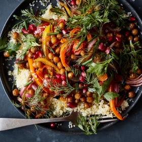

---
categories:
- 135D8DF8-5165-487A-9161-61345003AB1B
- F0D08EC3-D9EF-4F02-A381-FF3D38660DA6
- 3C8ADFAF-87C1-4C30-AA13-572072B4B626
- 2BBE169B-4709-4377-8F54-765FFAAD9E1A
cook_time: ''
created: '2023-07-15 13:30:53'
difficulty: ''
hash: 24136d266f78809775ffd06fed4ac2e51a630d53bfe73ead8a80792997c7f5f7
image_url: https://static01.nyt.com/images/2019/08/01/dining/mc-spiced-chickpeas/mc-spiced-chickpeas-videoSixteenByNineJumbo1600.jpg
in_trash: false
is_pinned: false
on_favorites: false
on_grocery_list: false
prep_time: ''
rating: 0
scale: null
servings: 4 servings
source: cooking.nytimes.com
source_url: https://cooking.nytimes.com/recipes/1020381-crispy-spiced-chickpeas-with-peppers-and-tomatoes
total_time: 30 min
uid: 04F7BEC2-93BA-4513-8AB7-81F7657ECC30
---

# Crispy Spiced Chickpeas with Peppers and Tomatoes

## Ingredients

- 2 (15-ounce) cans chickpeas, rinsed and patted dry
- 1/2 cup olive oil
- 2 teaspoons ground cumin
- 1 teaspoon ground coriander
- 1/2 teaspoon ground turmeric
- 1/4 teaspoon ground cayenne
- 1 teaspoon fine sea salt, plus more to taste
- 6 fresh thyme sprigs
- 2 red, orange or yellow bell peppers (or a combination), stems and seeds removed, sliced lengthwise 1/4-inch thick
- 2 medium tomatoes, diced
- 1 small red onion, sliced
- 2 jalapeños, stem and seeds removed, sliced
- Juice of 1 lemon
- 1 garlic clove, finely grated or mashed to a paste
- 1 cup fresh herbs (any combination of parsley, cilantro, mint or dill)
- 1/2 cup pomegranate seeds
- Couscous or rice, for serving (optional)

## Directions

Heat the oven to 450 degrees and arrange racks on the top and bottom thirds of the oven.

In a large bowl, toss chickpeas with 2 tablespoons oil, the cumin, coriander, turmeric, cayenne and 1/2 teaspoon salt until evenly coated. Spread onto a rimmed sheet pan in a single layer and top with 3 thyme sprigs.

On a second sheet pan, combine bell peppers, tomatoes, onion, jalapeños and remaining thyme sprigs with 2 tablespoons oil and remaining 1/2 teaspoon salt. Spread vegetables into one layer.

Place chickpea pan on the bottom rack and vegetables on the top rack and roast for 10 minutes. Switch pan positions. Roast chickpeas until crisped but still tender, about 5 minutes, and roast vegetables until golden brown, about 10 minutes. If the vegetables are tender but not browned, place the pan under the broiler for 1 to 2 minutes to caramelize. Discard thyme sprigs.

While the chickpeas and vegetables roast, whisk lemon juice, garlic and remaining 1/4 cup oil in a small bowl. Season with salt to taste.

Arrange vegetables on a large platter and drizzle with half the dressing, then top with crispy chickpeas, fresh herbs and pomegranate seeds. Drizzle remaining dressing over everything. Serve with couscous or rice, if you like.

## Nutritional Information

Trans Fat: 0 grams
Fat: 34 grams
Calories: 620
Saturated Fat: 4 grams
Unsaturated Fat: 26 grams
Sodium: 1110 milligrams
Sugar: 15 grams
Fiber: 19 grams
Carbohydrate: 67 grams
Protein: 18 grams
