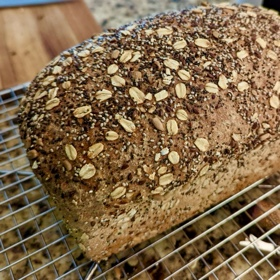

---
categories:
- 9B3E8F54-7F9D-4782-919F-ACC9A0850C87
- 60FB6093-F8C4-447B-A9A2-81A75BBCBA70
- E5311B89-BA3B-4153-9D9E-C809730BC236
- 2BBE169B-4709-4377-8F54-765FFAAD9E1A
cook_time: ''
created: '2022-08-15 11:58:21'
difficulty: Medium
hash: a93dd64c198ca194b52fd78cfca2b69dea512447c2d363a3ebd13a4b1aa21167
image_url: null
in_trash: false
is_pinned: false
on_favorites: false
on_grocery_list: false
prep_time: ''
rating: 0
scale: ''
servings: 1 loaf
source: ''
source_url: ''
total_time: ''
uid: CFF4D9B8-9895-495E-AB6D-0750F45C386E
---

# Dave's Bread - Chad's Copy Cat

## Ingredients

- **Poolish:**
- ------
- 115 g All Purpose Flour
- 115 g Wheat Flour
- 230 g Water, 100℉
- 0.5 g (1 pinch) instant yeast

- **Day of Bake:**
- ------
- _Base:_
- 115 g All Purpose Flour
- 115 g Wheat Flour
- 27 g Vital Wheat Gluten Flour
- 115 g Water, 105℉
- 18 g Fine Sea Salt
- 6g Instant Yeast

- _Dough Enrichments:_
- 3 T Olive Oil
- 4 T Honey
- 1/2 C Uncooked Old-Fashioned oats
- 1/4 C Sunflower Seeds
- 3 T Flax Seed - Ground 
- 2 T Flax Seeds - Whole
- 2 T Amaranth
- 2 T Chia Seed
- 2 T Raw Pumpkin Seed
- 1 T Sesame Seed
- 2 T Poppy Seed

- _Seed Coating Mix:_
- 1/2 C seed mix
- * Use your preferred ratio seeds from the enrichment section.

## Directions

Poolish: 
------

Mix flour, water, and yeast in a bowl with space to rise.  Cover and let sit at room temperature for 12-14 hours.  Should peak fermentation at around 12 hours in average room temp.

Day of Bake:
------

_The Mix:_
Add all ingredients into a food mixer bowl (including the fermenting poolish) and mix for 10 minutes with a dough hook attachment; Dough should become reasonably strong, and most material should have been pulled away from the sides of the bowl.

_The Rise:_
Lightly coat the edge of a bowl to be used as the rising container with olive oil.  Place dough in a bowl and toss to coat with oil.  Cover the bowl and allow to sit for 1.5 - 3 hours until doubled in size.

_The Proof:_
Form a loaf, lightly coat it with water or oil, and roll it in your seed mix.  Place the loaf in a loaf pan, let proof for 1 - 2.5 hours until it is rising above the edges of the pan and passes the standard proof test.

_The Bake:_
Allow oven to preheat to 350℉ at least 45 minutes, with a pizza stone at lowest rack level.  Use cast iron pan in the bottom of the oven or spare loaf pan to hold ice cubes or water to create humidity.  Bake dough for 50 - 60 minutes until internal temp reaches 200℉

_The Rest:_
Remove bread from loaf pan immediately, place on wire rack to cool for at least 40 minutes before cutting.

Enjoy!
