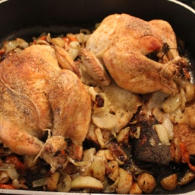

---
categories:
- 135D8DF8-5165-487A-9161-61345003AB1B
- E131025A-19E9-4C5F-99A8-75EE51F165D8
- 1C21D75E-3CF2-4B23-B04F-A9275BC1033B
- 2BBE169B-4709-4377-8F54-765FFAAD9E1A
cook_time: ''
created: '2020-02-23 10:03:43'
difficulty: ''
hash: 0b3286f60f7a1ff5db1b08594a7758a6da7112d3375d32f92300925381ee6848
image_url: https://secureservercdn.net/198.71.233.161/fv4.276.myftpupload.com/wp-content/uploads/2019/01/smaller-wc-IMG_4655-1080x720.jpg
in_trash: false
is_pinned: false
on_favorites: false
on_grocery_list: false
prep_time: ''
rating: 0
scale: null
servings: Serves 4
source: cookingbythebook.com
source_url: https://cookingbythebook.com/recipes/dories-roast-chicken-for-lazy-people-les-paresseux/
total_time: ''
uid: FCF81912-CC08-43EF-874E-358CE8B22EB2-30191-000016708727D662
---

# Dorie’s Roast Chicken for Lazy People [Les Paresseux]

## Ingredients

- Olive oil
- 1 thick slice bread or 2 slices baguette
- 1 chicken, 4 1/2-5 lb, preferably organic (reserve the liver if it came with the chicken), at room temperature
- Salt and freshly ground pepper
- 2 sprigs rosemary
- 2 sprigs thyme
- 2 sprigs oregano
- 1 garlic head, cut horizontally in half, unpeeled
- About 2/3 cup dry white wine or water (optional)
- 4 baby potatoes, scrubbed and quartered (optional)
- 2 carrots, trimmed, peeled, and cut into thick chunks (optional)
- 4 shallots, left whole, or 1 onion, quartered (optional)

## Directions

Center a rack in the oven and preheat the oven to 450°F.

Rub the inside of a Dutch oven or other large high-sided casserole with oil and place the bread in the center of the pot. Season the chicken inside and out with salt and pepper. Put the liver, if you’ve got it, inside the chicken and toss in a half sprig of each of the herbs as well as one half of the garlic. Put the chicken in the pot, resting it on the bread. Put the other garlic half in the pot, along with] the remaining herbs, and pour in a few tbsp each of oil and the wine or water, if you’re using it. Slide the pot into the oven.

If you’d like to roast the vegetables with the chicken, wait until the chicken has roasted for 45 minutes. Then toss the potatoes, carrots, and shallots with enough olive oil to give them a shine, season generously with salt and pepper, and scatter them around the chicken. Roast the chicken undisturbed for about 45 minutes more — a total of about 90 minutes — or until the skin is crackly and crisp and the juices run clear when you pierce the thickest part of the thigh with the tip of a knife. Remove the chicken from the oven.

If you’re feeling really lazy, you can leave the chicken in the pot for 5-10 minutes to rest before serving. If you’ve got a bit more get-up-and-go, to get the juices back into the breast meat, put a cereal bowl at one end of a large platter and transfer the chicken, breast side down, to the platter. Let it rest under a foil tent, tail leaning on the bowl and pointing up, for 5-10 minutes before serving.

Should you want a little pan sauce — and you’ll only get a little — spoon the vegetables, if you’ve got them, into a bowl, remove the bread, and skim off as much of the fat remaining in the pot as possible. Put the pot over high heat, and then the liquid boils, pour in about 1/2 cup wine or water and cook, scraping up whatever bits may have stuck to the bottom of the pot. Remove from the heat.

Carve the chicken and serve with the sauce, if you made it.
